# MCVSAID — MultiCam Video Stream AI Director

**Turn a handful of Android phones into a multi-camera live production, kept in sync, and directed automatically.**

**[Why MCVSAID?](WHY-MCVSAID.md)** What it does that other phone multicam tools and auto-directors don't, and how it
compares. **[Try the demo](https://mcvsaid.github.io/)**: the real dashboard with simulated cameras, in your browser.

MCVSAID makes ordinary Android phones into remotely managed cameras for live music and events. Each phone streams
its picture to [OBS](https://obsproject.com/) on a production computer. A manager on that computer keeps every feed in
step, watches the health of every phone, matches their colours, and can choose the shots itself with a vision model
running on the computer's own graphics. Cameras can be mounted out of reach: everything is done from a browser.

It directs **live music, church services, podcasts and talk shows, panels and conferences, theatre and comedy, and
cooking shows**, each with its own camera roles, pacing and way of choosing shots, and has a **Creator Studio** for
people recording themselves, where you define the framings yourself. And it runs at the level of **AI assistance** a
production wants: none at all, a vision model on the computer itself, or that model plus recognition of consenting
performers.

**New: cameras on gimbals that aim themselves.** Put a phone on a Hohem iSteady X3 or MT3 gimbal and aim it from its
camera card, or press **Follow** and the phone keeps the most prominent face (or a named, consenting performer) in
frame by itself: see [Gimbals](#gimbals-aim-a-camera-or-let-it-follow-experimental).
**Face blur, now on the phones**: a camera can blur every face before anything leaves it, with the production computer
watching as a backup for any face it misses: see [Face blur](#face-blur-experimental).

**Linux or Mac.** The production computer can run Linux or macOS. It was built on a Linux workstation and now runs live
on a **MacBook Pro with an M5 Pro and 48 GB of memory**: OBS, the manager and the shot-choosing model all on the one
laptop (see [The production computer](#the-production-computer)).

This repository holds the **signed builds of the camera app**, under [Releases](../../releases). A phone being set up
fetches the app from here; the app does nothing by itself until it is paired with an MCVSAID manager.

> The screenshots below are from a demonstration manager with six made-up cameras and drawn pictures, not a real show.

### Join the beta

MCVSAID is in a **private beta**. If you are interested in filming live events with phones (a church, a theatre, a school, a venue, a band,
a podcast or a kitchen) and would like to try it, email **mcvsaid@proton.me** with:

* what you film, and how often;
* the computer you would run it on (Mac or Linux, and its memory);
* the phones you could set aside for it, and your network.

Testers get the manager from a private repository, a tester guide, and a direct line for feedback. Camera phones must
be **spare phones, factory-reset and used for nothing else**: the app becomes each phone's device owner.

---

## How it fits together

```
 Android phones (camera app)                    Production computer (Linux or Mac)
 ┌──────────────┐  picture + sound (SRT)   ┌──────────────────────────────────┐
 │ Stage Left   │ ───────────────────────▶ │ camera relay: keeps each stream  │
 │ Stage Right  │                          ├──────────────────────────────────┤
 │ Drums  …     │                          │ OBS: one source per camera,      │──▶ recording,
 │              │  control (TLS, pinned)   │ full-screen and split scenes     │    live stream
 │              │ ◀──────────────────────▶ ├──────────────────────────────────┤
 └──────────────┘                          │ MCVSAID manager                  │◀── browser on the
                                           │  · readiness and health          │    computer, a tablet,
                                           │  · feed alignment                │    or a phone
                                           │  · shot choosing (by hand or AI) │
                                           │  · colour matching               │
                                           │  · recordings                    │
                                           ├──────────────────────────────────┤
                                           │ vision model, person detector    │
                                           │ (optional, on this computer)     │
                                           └──────────────────────────────────┘
```

* Each phone streams over **SRT**. It can also record its own full-quality copy, if it stays cool enough doing both;
  the production computer can instead keep every camera's stream itself, as it arrives.
* Every picture carries a small **timing strip**, which the manager reads to line all the feeds up to the frame; OBS
  never shows it.
* The **camera relay**, on by default, holds the look-ahead as compressed video rather than OBS holding it as pictures:
  six 4K cameras took OBS from 11.0 GB of memory to 2.6 GB. It can also keep each camera's own file of a recording.
* The control connection is **encrypted and pinned** to the manager's certificate. Phones find the manager by its
  address or by a name on the local network.

---

## The show at a glance

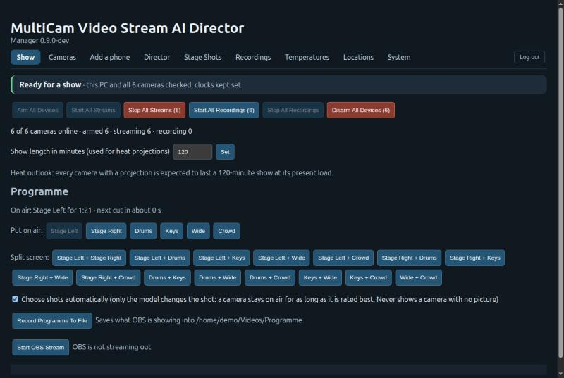

The dashboard is grouped by when things are needed: **Show** (Show, Cameras, Stage Shots, Temperatures), **Set up**
(Director, Colour, People), **Library** (Recordings) and **Administration** (System). The show's state (ready, on air, recording)
stays in view at the foot of the side bar.

One line answers the question that matters before doors open: **is everything ready?** It is worked out continuously
from the computer (OBS, memory, processor, recording space, the camera network, the relay, the model) and from every
camera (connection, clock, power, temperature, Wi-Fi, stream target, picture in OBS, frame rate, colour, sounds, its
cooler), and names what
needs attention, with what to do about it. Below it: the programme, what is on air, any camera or split screen one press
away, recording and streaming, starting and stopping every camera at once, and a heat outlook for the length of the
show.

## Live music, worship, podcasts, panels, theatre, cooking

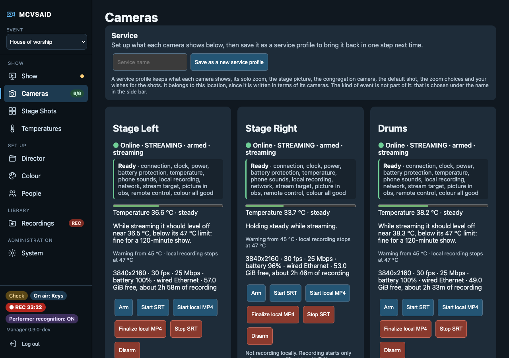

The kind of event is chosen at the top of the side bar. Each kind offers its own roles for what a camera shows (a
pastor, a reader, the choir and the congregation for a service; a host and guests for a podcast; a moderator and
panelists; a performer and the house for theatre), uses its own words with the shot-choosing model, and keeps its own
pace. For podcasts, panels and services, with each microphone on its own channel of a mixer, the director **switches to
whoever is talking**, allowing for bleed between mics, coughs and pauses; laughter and applause bring in the audience
camera.

**Cooking** treats the food as the star as much as the cook: the board while hands cut, the stovetop while something is
in the pan, the oven while its door is open, the plate at the end, with the kitchen's own sounds pointing to the busy
station. Load a recipe from a web page or pasted text on its own **Recipe** page and the director follows its
preparation and steps, makes sure each step's key station is seen, marks the steps in the recording, and can show the
recipe, a QR code to it and step captions in OBS. Every step is listed with its time and key shots; go to any step,
mark it done or skipped, edit and reorder steps during the show, and undo. With spoken cues on (Standard or Plus AI),
the cook says "let's see that recipe", "back to step two" or calls out an ingredient, and the recipe, the step or the
ingredient's line goes on screen while the AI keeps directing the shots; speech is recognised on the production computer and nothing heard is kept.

**Explain the director, on the video.** For demo videos, switch on *Explain the director* and the programme carries
caption cards saying what the AI did and why: each cut and who made it, a solo heard, a gimbal turning to the soloist, a
lens change, a voice call, and now and then a feature in use. They are recorded with the programme, so the video shows
how it was made. Performers are never named.

**Voice shot calls.** In Cooking and Creator Studio the host can call a shot aloud: "cut to the overhead", "show the
stove", "wide shot". The director cuts to that camera at once and holds it before choosing again by itself. Each camera
answers to its name, what it shows and phrases you give it; a name in passing, a question or "don't cut to the stove"
does nothing. Off by default where music, a congregation or several talkers could call cameras by mistake, and switched
on or off for each kind of event on the Director page.

**Voice zoom calls.** "Close up", "zoom in", "pull back": the camera on air zooms, gliding on the phone and handing over to
its telephoto on the way, and the director holds the shot. A band can give it a cue of its own that nobody sings ("camera,
close on me") for a performer to call a tighter shot themselves.

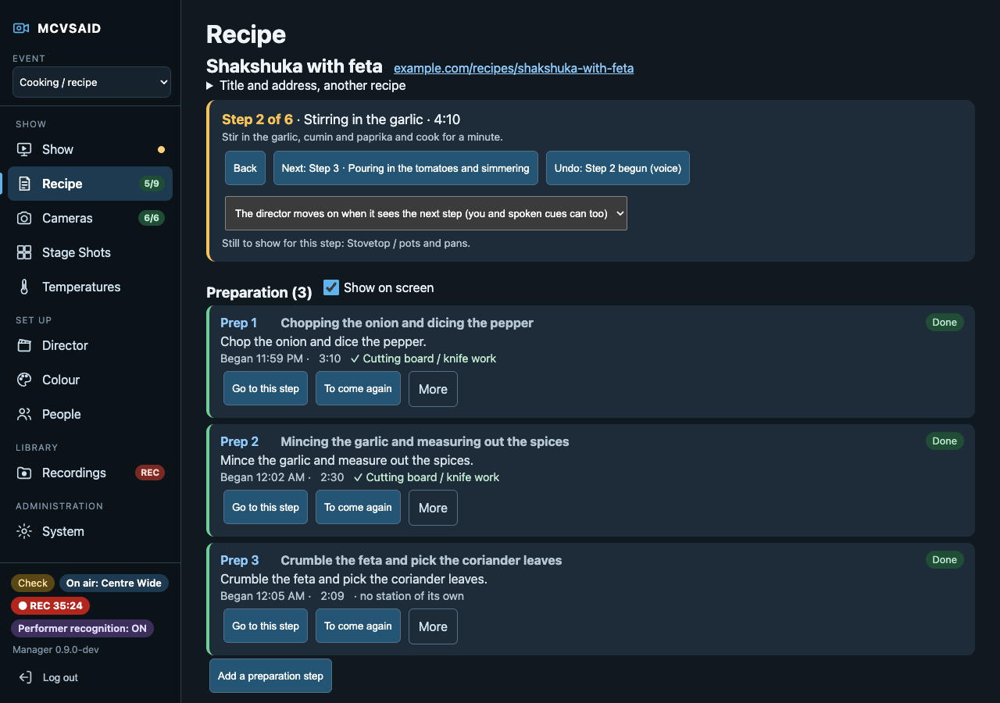

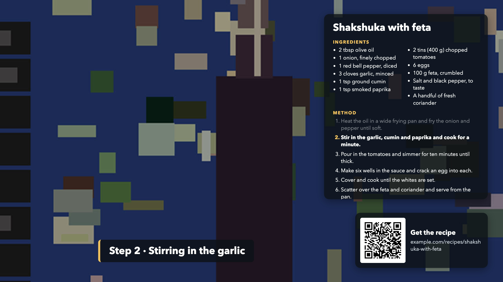

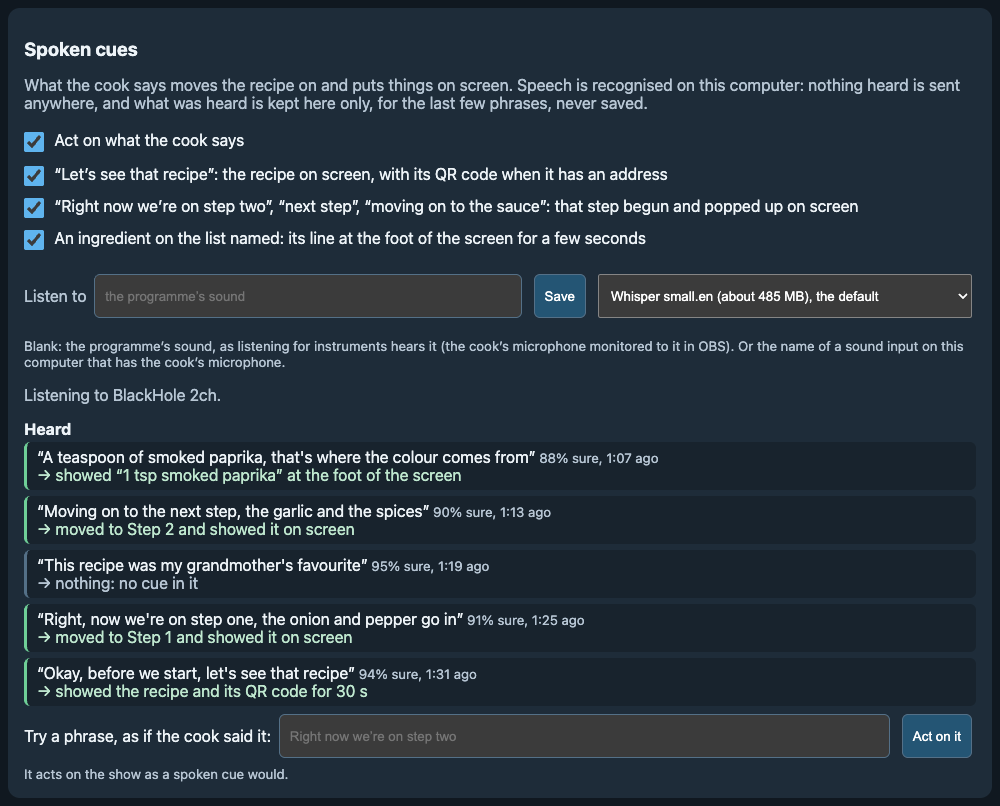

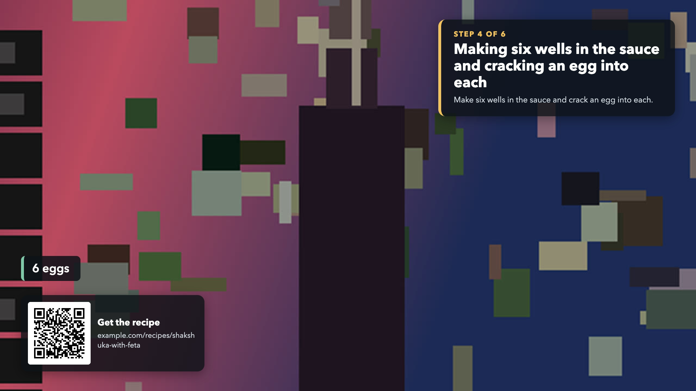

**Creator Studio** is for one or a few people recording themselves, and nothing in it is preset: build your own
framings from body regions (head, shoulders, hands, hips, knees, feet), choose how close each camera shoots and when it
cuts. It needs Plus AI's person detector and a body keypoint model, both run on the computer.

## Every camera, in detail

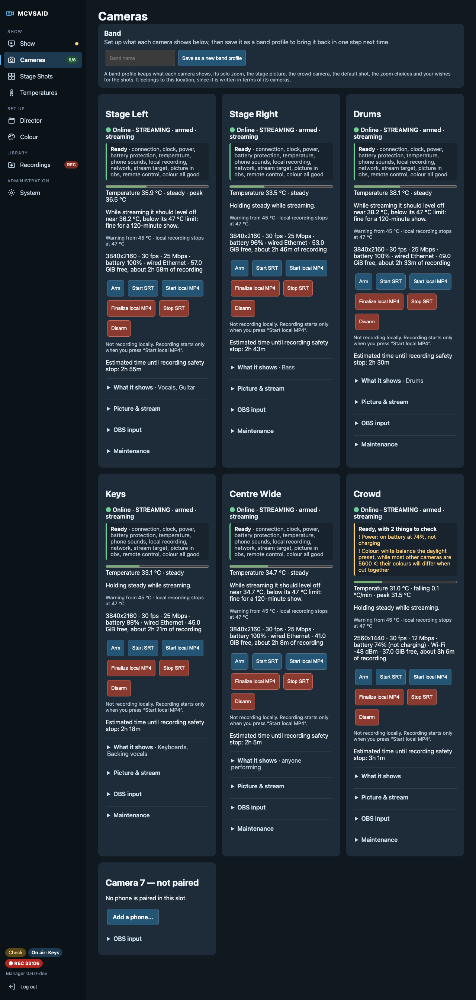

Each camera has a card: online and streaming, a readiness summary, temperature with its trend and a forecast, battery,
network, free space, and its controls. The rest folds away until needed. **Band profiles** save who stands where, so
the same band on the same stage is set up in one step.

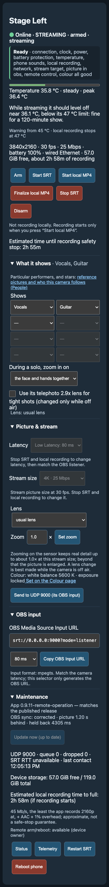

Opened out, a card sets which performers or instruments the camera shows (up to eight), where to zoom during a solo,
whether the director may use its **telephoto lens**, the stream size and latency, the lens and **sensor zoom**, its
cooler where it has one, and its app version and maintenance: all from the computer, while the phone stays on its mount. Clocks are set
automatically, and app updates roll out one unarmed camera at a time.

<br clear="right">

## Stage Shots

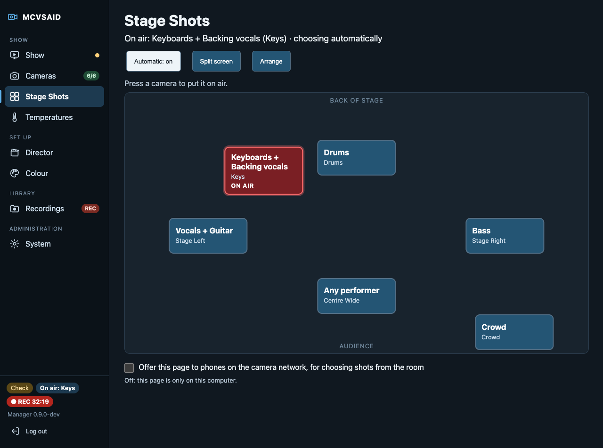

The cameras laid out as they stand on the stage, by what they show, read from the back of the stage to the audience,
with stage left and right as the performers have them. Press one to put it on air, or pick two for a split screen.
A tight shot is a narrow button and the whole band a wide one, and a mark on each shows where its camera stands,
which way it points and how wide it sees, and the room map's wedges are drawn across the stage behind the buttons. **Arrange** moves and sizes the buttons, and a **room map** from above places and turns each
camera and shows the wedge it sees, worked out from its lens and zoom. **Room view** puts the two together: the buttons
stand on the map's stage among the cameras that film them. Experimentally, **Place from the wide shot** finds each
camera's picture inside the wide camera's and offers where its button should go: on the performer it shows, with the
person detector. With a vision model it also suggests who that is, and asks "guitar or bass?" when it cannot tell.
The page can be offered to phones on the camera network, behind its own passcode, so someone in the crowd can call the
shots by hand.

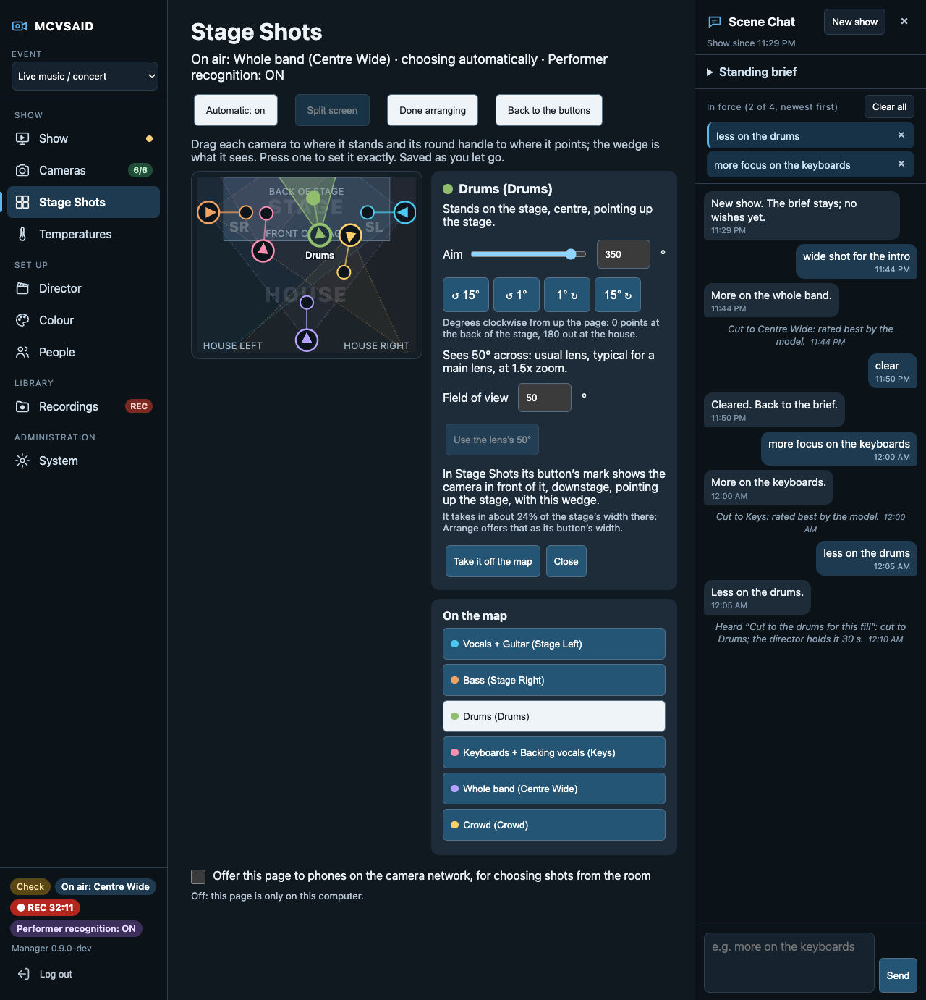

## Temperatures, run by run

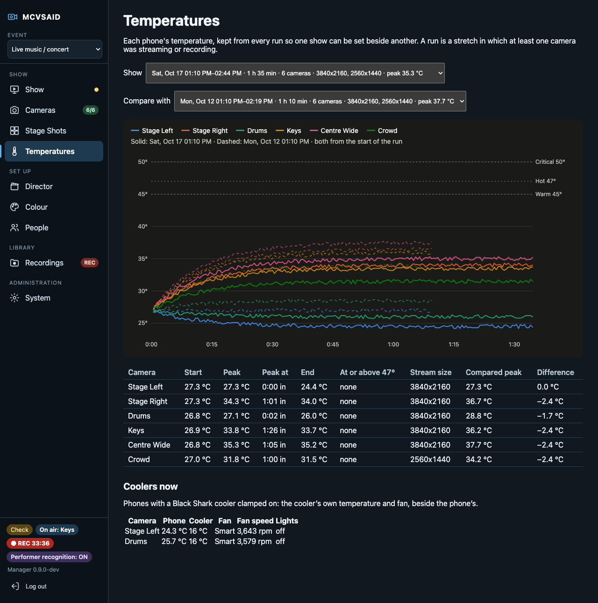

Every phone's temperature is kept from every run, so one show can be set beside another: which camera ran hottest, how
long it took to settle, and whether a change of mount or picture size helped. Phones with a cooler clamped on have it
listed beside them: the cooler's own temperature, its fan and its lights. (In the demonstration, Stage Left and Drums
have one.)

## AI assistance: none, Standard or Plus

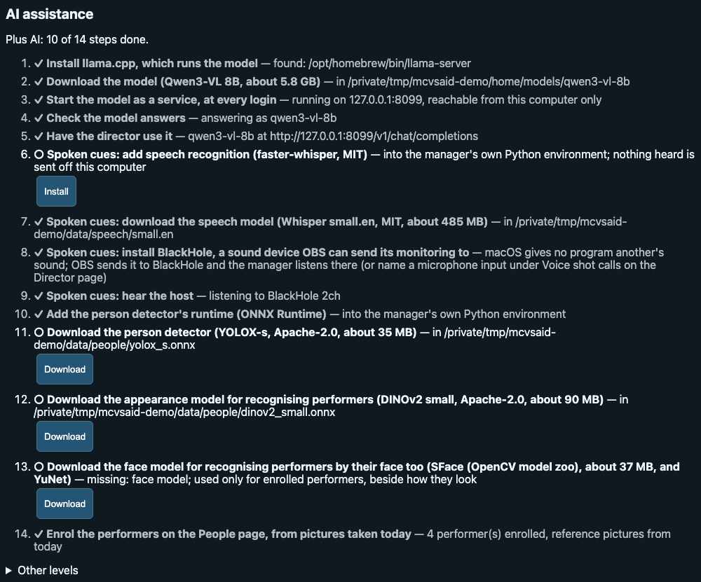

How much AI helps is a choice for each installation, so a modest computer can still run a show:

| Level | What it does | What it needs |
| --- | --- | --- |
| **No AI** (the default) | Shots by hand, from Stage Shots, by timed rotation, or switched to whoever is talking; the safety rules still cut away from a camera that fails | Nothing extra: no model is downloaded or run |
| **Standard** | A vision model on the computer rates every camera, zooms in on and follows a performer, listens for the instrument to the fore, and can cut to the camera a performer looks at | About 7 GB of graphics memory: an Apple silicon Mac with 32 GB or more, or an NVIDIA card with 8 GB or more |
| **Plus** | Standard, and consenting performers recognised: stars given priority on any camera, cameras that follow a named performer, framed ten times a second by a fast person detector | Standard's, and a small person detector (YOLOX-s) |

Choosing a level shows its set-up as steps, each checked live: a button for what the manager can do itself (download
the model, run it as a service on the computer only, point the director at it, add the detector), and a ready-to-copy
command for what needs an administrator's password. It also says honestly whether a level fits the computer. Listening
for instruments has its own steps, down to the OBS settings that let the manager hear the programme.

## The director

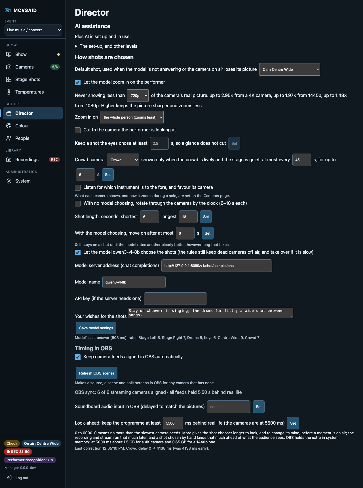

Shots are chosen by a **vision model** running locally (any OpenAI-compatible server; llama.cpp with Qwen3-VL 8B here),
guided by plain-language wishes ("stay on whoever is singing; the drums for fills"). A **look-ahead** holds the
programme a few seconds behind real life, so the model sees each moment in the phones' own pictures before it airs and
every cut lands cleanly. The director can also:

* **zoom in on a performer and follow them**, leading a walker with room ahead, and never zooming in on nobody: empty
  pictures, boxes no person could fill and scenery the model keeps mistaking for a person are all refused;
* use a camera's **telephoto lens** for tight shots, changing lens only while that camera is off air;
* **cut to the camera the performer is looking at** (on a Mac, with Apple's Vision framework; off unless chosen);
* **listen** to the programme sound to favour the camera on the instrument that is to the fore;
* show the **crowd camera** when the crowd is lively and the stage is quiet.

Without a model it can rotate through the cameras on a timer, or leave the choice to a person.

### Scene Chat: guiding the director through the show

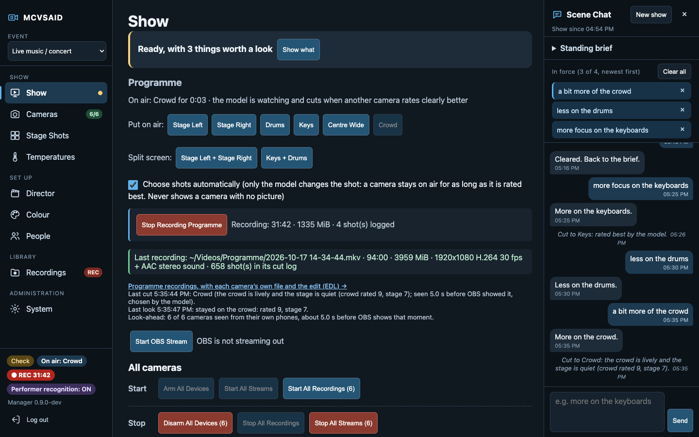

Down the right of the Show and Stage Shots pages, **Scene Chat** feels like talking to the director. A **standing
brief** says what holds all show; during it, type wishes as they come ("more focus on the keyboards", "less on the
drums") and they go on top of the brief, newest first, for the model's next look. The director answers each at once
("More on the keyboards.") with a canned reply, so the chat never costs the model any time, and notes what came of it
("Cut to Keys: rated best by the model."). A newer wish about the same thing replaces the older, four at most are in
force, each lasts 15 minutes unless cleared, and "clear" goes back to the brief. On a tablet it opens over the page,
on a phone it is a sheet from the bottom; it needs Standard or Plus AI, and keeps the show's chat until New show.

## People: consenting performers, and nobody else

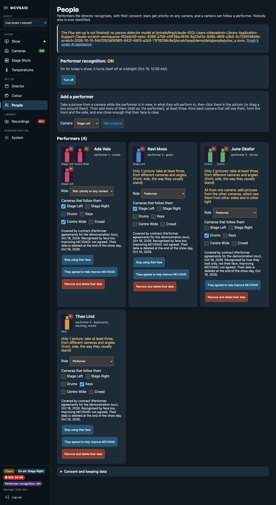

At Plus, performers who have agreed can be enrolled on the day: take a picture from a camera, click the performer the
detector outlines, and give a name, a role (a **star** gets priority on any camera) and the cameras that **follow
them**. Reference pictures are taken in what they will perform in.

* **Consent per purpose**: being recognised during the show, and, separately and optionally, helping improve MCVSAID.
  One tick confirms a performer's signed release, or the production says once that releases are handled by contract.
* **Nobody else is identified.** The director only ever recognises enrolled performers, and never zooms in on someone it
  does not recognise.
* **Faces only with their own consent.** Where a performer's release covers their face, a clear face is used beside
  how they look; otherwise only their appearance is.
* **Kept briefly and encrypted**: a small thumbnail and appearance (and, where agreed, face) descriptors, deleted
  at the end of the show day unless the production chooses longer, and at once on removal or "Delete all performer data". Logs say "performer 2",
  never a name. Pictures kept to improve MCVSAID are pseudonymised, with everyone else in them blurred.
* **Faces, only with their own consent.** Where a performer's release covers their face, a clear face is used beside
  how they look, and outweighs a matching costume.
* While recognition is on, every page says so.

The people in this screenshot are made up, and their pictures are drawn figures.

## Face blur (experimental)

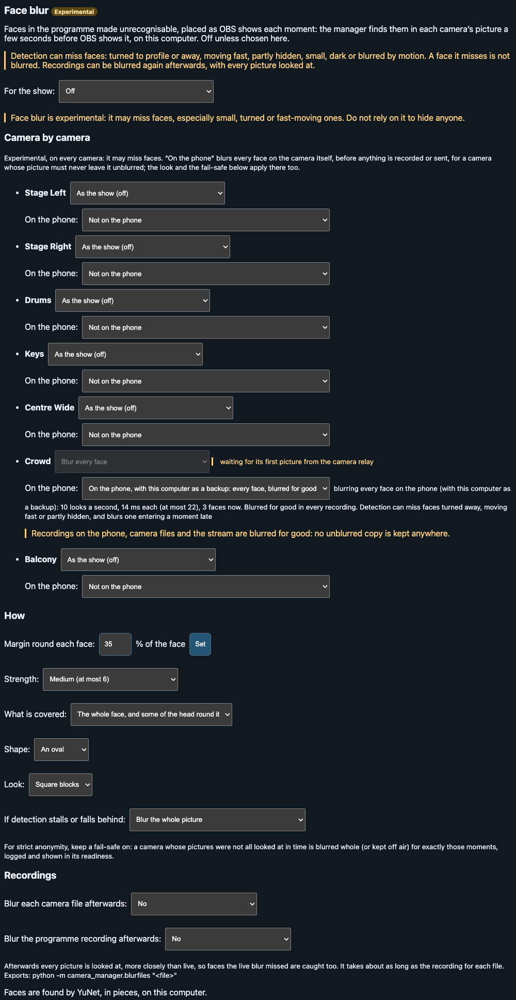

**On the phone first.** A camera whose picture must never leave it unblurred can blur every face **on the phone
itself**, before anything is recorded or sent: its stream, OBS, the computer's copy and the phone's own recording are
all blurred for good, and no unblurred copy exists anywhere. The phones now find faces with the same detector as the
computer (YuNet), which finds turned and small faces too: on test scenes it found 78–84% of faces, against 31–38% for
the phones' earlier detector.

**The computer as a backup.** With *On the phone, with this computer as a backup*, the production computer keeps
watching that camera a few seconds ahead of the programme and covers in OBS any face the phone left showing: one
walking in before the phone has looked, or one it lost for a moment. The phone reports where it blurred each frame,
so the computer knows which faces it already covered and adds only what was missed. If the phone's own looks stop, it
blurs its whole picture.

**On the computer alone**, faces are blurred live in OBS for the whole show or camera by camera: every face, everyone
except consenting performers, or only chosen performers, covered before OBS shows them, with a fail-safe that blurs a
camera whole if its pictures were not all looked at in time. Recordings can be blurred again afterwards, every picture
looked at more closely.

**It is experimental and can miss faces**, especially small, turned or fast-moving ones, so it is hidden and off until
an administrator switches it on, and it should not be relied on to hide anyone.

<br clear="right">

## Colour that matches from phone to phone

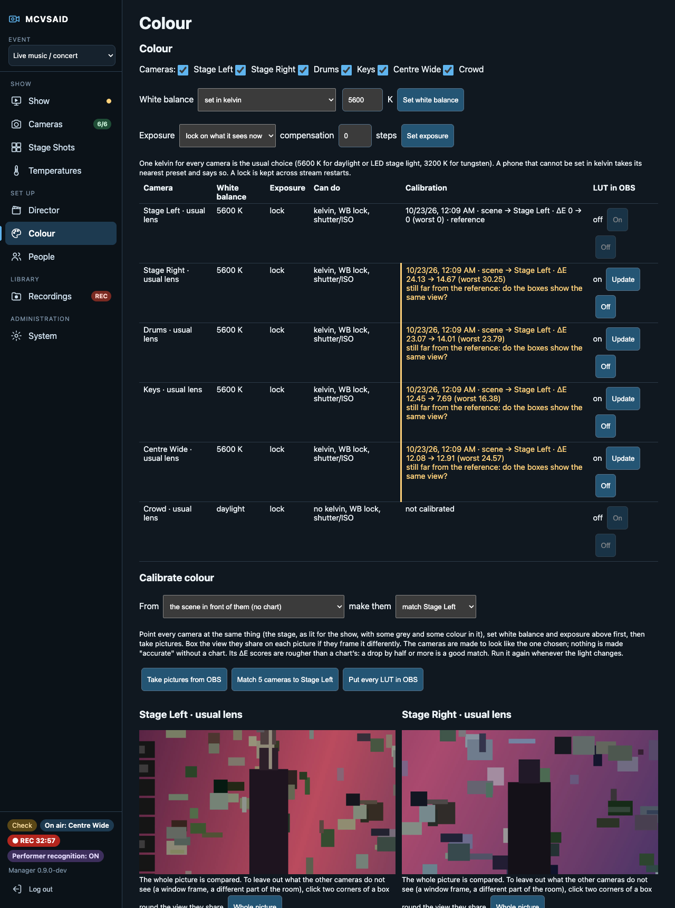

Phones of different makes see the same stage differently. From one page, every phone is set to the same **white
balance** (in kelvin, where the phone allows it, or its nearest preset) and its **exposure locked**, and each camera
gets a correction **LUT** in OBS: fitted from a colour chart, or by matching every camera to one of them on the scene
in front of them, no chart needed. The LUTs go with each recording's camera files, for the edit.

## Recordings

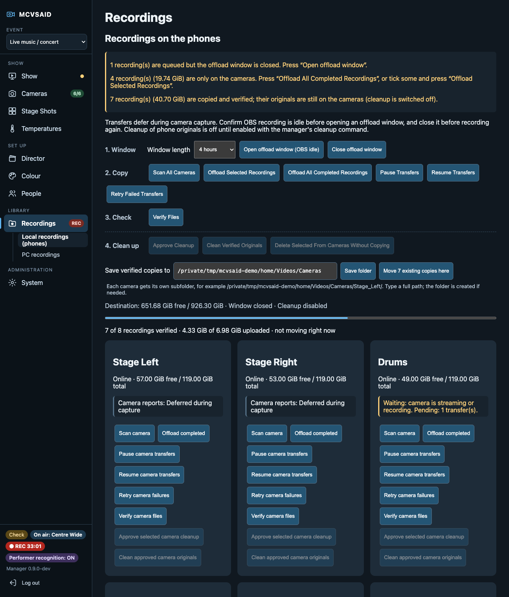

**On the phones.** Each phone can record its own full-quality copy while it streams, and the copies are taken to the
computer over the network after the show, verified, and filed by camera. Phones' copies are only ever cleared when that
is explicitly switched on. Recording and streaming together makes a phone work harder and run hotter: in testing it ran
some phones too hot to use, so **test it on the intended phones**, at the intended picture size, for the full length of
a show. A clamped-on phone cooler changes that: see [Phone coolers](#phone-coolers-experimental).

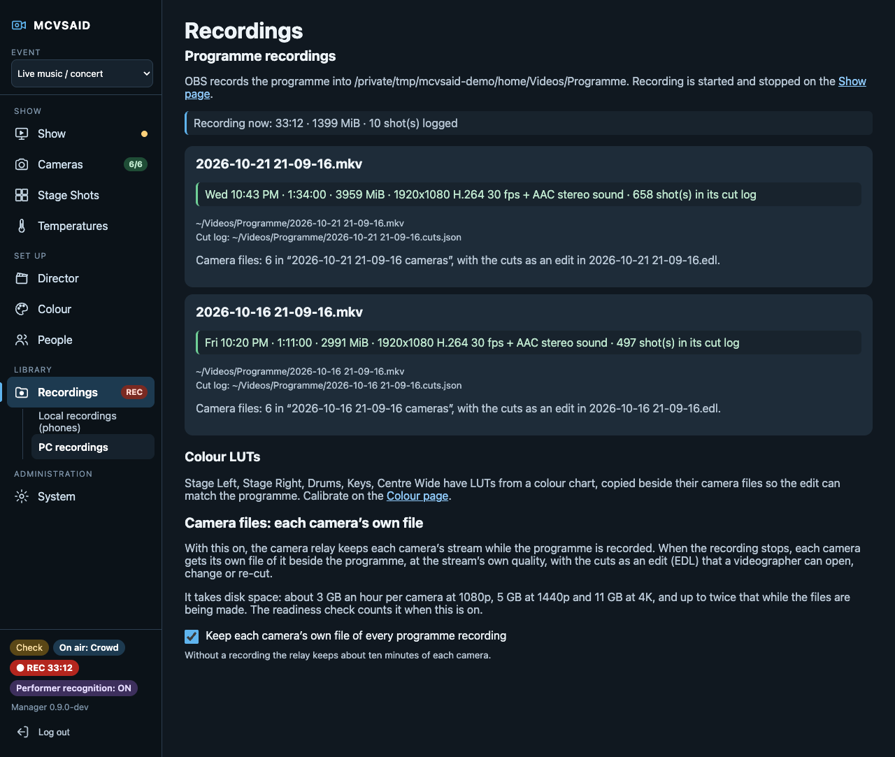

**On the computer.** The production computer can keep every camera's stream as it arrives (camera files, through the
camera relay), at no cost to the phones. Each programme recording then comes with one file per camera, the cuts as an edit (EDL) a
videographer can open in Resolve, Premiere or Final Cut and re-cut, and each camera's colour LUT. Camera files are a
setting of their own, off until chosen, since they take disk space.

## Adding a phone

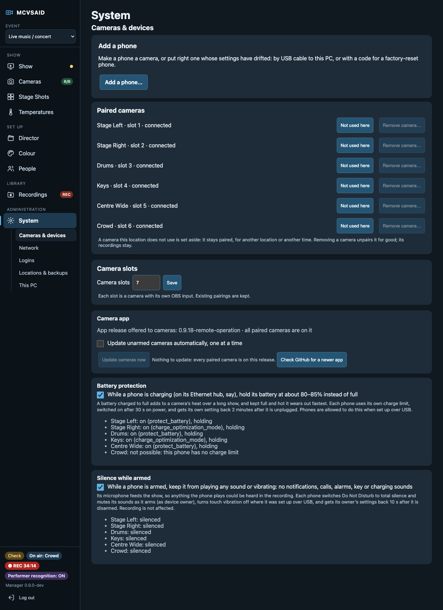

Plug a phone in by USB and the manager installs the app, grants its permissions, makes it the phone's manager (so it
can be armed, restarted and updated remotely), exempts it from battery saving and pairs it: each step checked first and
skipped when already done, so the same page repairs a phone whose settings have drifted.

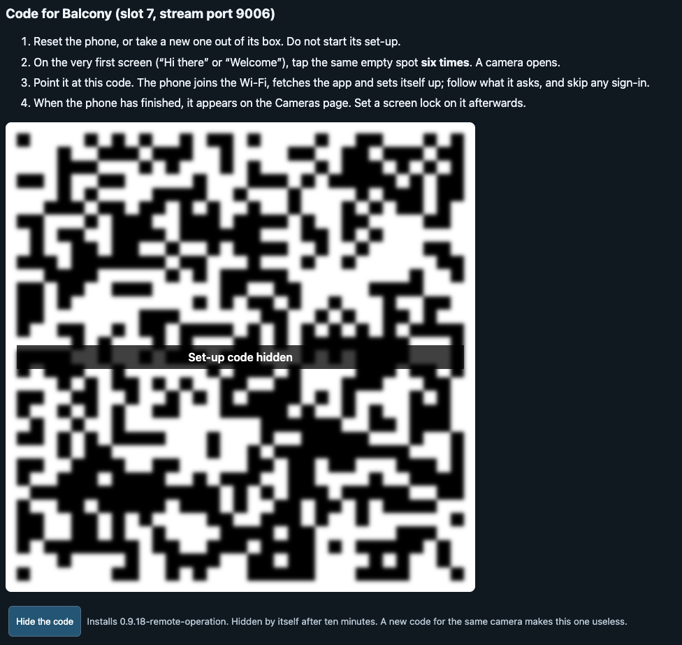

**No cable at all:** a factory-reset phone taps its welcome screen six times and scans a code. It joins the Wi-Fi,
downloads the app from this repository, checks it is signed with the installation's key, sets itself up, moves to the
camera network and connects. The code carries everything the phone needs; the manager keeps none of its secrets.

<br clear="right">

## Cameras that look after themselves

Phones mounted out of reach have to keep going on their own:

* **A frozen picture is revived.** If a phone stops producing pictures while its sound goes on, the app reopens the
  camera, then restarts the capture, by itself; the manager also rebuilds an OBS source that plays with no picture.
* **The camera Wi-Fi is rejoined** by an armed phone that loses it (a router restarted, say), without anyone touching it,
  and by a phone that is on it but cannot reach the manager (after roaming between a router's access points, say).
* **Battery protection.** A phone charging all show from its Ethernet hub holds its battery short of full, which keeps
  it cooler, where the phone has a charge limit.
* **Silence while armed.** An armed phone plays no notification, call, alarm, key click or charging sound that its
  microphone could carry into the show, and gets its owner's settings back once disarmed.
* **Clocks.** A camera whose clock has drifted is shown with a **Fix** button that takes it off air, sets its clock and
  brings it back, in step.
* **Phone coolers.** A clamped-on Black Shark cooler is controlled from the dashboard over Bluetooth: see
  [Phone coolers](#phone-coolers-experimental).
* **Gimbals.** A phone on a Hohem gimbal is aimed, and can follow someone, from the dashboard: see
  [Gimbals](#gimbals-aim-a-camera-or-let-it-follow-experimental).

## Gimbals: aim a camera, or let it follow (experimental)

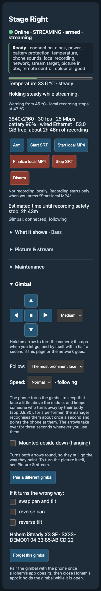

A phone on a **Hohem iSteady X3 or MT3** gimbal becomes a camera you can point from the dashboard. The camera app talks
to the gimbal over Bluetooth, so nothing else is needed: no extra box or cable, and no Hohem app running.

* **Aim it.** Hold an arrow on the camera's card and it turns, at the speed chosen; let go and it eases to a stop. If
  the page closes or the network drops, it stops by itself within half a second.
* **Let it follow.** Choose **Follow → the most prominent face** and the phone finds faces in its own picture and keeps
  that face a little above the middle, turning the gimbal calmly, at a **Calm, Normal or Quick** pace. Someone who turns
  away or walks too far for their face to be found is still followed **by their body**. Touch an arrow and you have it
  for three seconds; then following carries on.
* **Follow a performer** (Plus AI): choose a named, consenting performer, and the manager recognises them in that
  camera's picture about once a second and points the phone at them, so the director's zoom on that camera follows
  them too.
* **Solos and guests** (Plus AI): give a gimbal camera a **follow plan**: its performers in order, with **solos taking
  over** (the sound hears a guitar solo and the gimbal turns to the guitarist, even one this camera doesn't usually
  follow), optionally **prominent players** too, and **anyone** when none of them is in view, so a guest who walks on
  from the other side of the stage is followed. It holds each choice a few seconds so it doesn't flit, and says why it is
  on whom it is.
* **The zoom follows the plan**: the director's zoom on that camera frames whom the plan is on, the soloist or a guest,
  not just a listed performer.
* **Home position**: **Set home** where it points now, and **Home** turns it back there.
* **If it loses them**, the director takes that camera off air before the audience sees an empty shot (the programme
  runs a few seconds behind): to the best other camera when the AI rates one, otherwise to the stage shot, and it
  doesn't cut back until the gimbal is following again.
* **Aimed from the stage** (Plus AI): with the cameras on the room map, and the gimbal aimed at centre stage and **Set**
  once, the manager uses the wide shot to turn a gimbal that has lost someone back towards where they are, and one
  given a performer towards them before the director needs it. The phone's own following takes over once they are in
  its shot.
* **An MT3's own AI tracker** is shown on the card when it is tracking, and the arrows warn that they would fight it.
* **Hung upside down** from a bar or truss: one tick turns both arrows round, and **Turn picture 180°** (for any phone
  mounted upside down) turns the picture itself.
* **Pairing from the dashboard.** A phone looks for a gimbal or cooler when asked; one can be moved from one camera to
  another, and all coolers re-paired at once, each to the phone it is clamped to.

**Steer it with an Xbox controller.** The **Operate** page shows the cameras you choose live, with no look-ahead, for
the administrator or an operator. The right stick aims the gimbal, the triggers zoom, **A** puts that camera on air,
**View** goes back to the stage shot and **Y** to the previous shot, a right-stick press sends the gimbal home; the
bumpers change camera, and several controllers can drive several cameras at once. Each tile has the same Follow
control and follow plan as the camera's card, and Home and Set home.

The commands were worked out from Hohem's own app, so a firmware update could change them. (In the demonstration,
Stage Right is on a gimbal; its pictures are drawn, so nothing moves.)

<br clear="right">

## Phone coolers (experimental)

Heat is what limits a phone camera: a phone streaming 4K for a whole show can run warm enough that recording its own
copy at the same time is not safe, and the app stops recording at 47 °C to protect the phone and the file. A
**clip-on thermoelectric cooler** removes most of that heat.

**What we measured** (one evening each, so treat them as early results):

| | Without a cooler | With a Black Shark MagCooler 5 Pro |
| --- | --- | --- |
| Galaxy S23, 4K at 25 Mb/s | streaming only: 43–44 °C within the hour | **streaming and recording together for 2¼ hours: 22–25 °C** |
| Galaxy S20 FE, 4K at 25 Mb/s | streaming only: up to 50 °C | streaming, and briefly recording too: 5–15 °C |

So with a cooler, **recording on the phone while it streams becomes practical**, for a full-quality copy of every
camera even when the network or the production computer has a bad moment.

**Recommendations**

* **Smart fan mode** (the default here): the cooler follows the phone's temperature. Use more only if a phone still
  warms up.
* **Watch for condensation.** These coolers can chill a phone below the room's temperature (the S20 FE read 5 °C), and
  water can then form on it, inside it or on the lens, in a humid room especially. Keep it in Smart, and let a cold
  phone warm up before taking the cooler off.
* **Power the cooler from its own USB charger**, not from a PoE-to-USB-C adapter on the camera network's switch: one
  such adapter took a whole camera network down in testing.
* **Switch its auto shutdown off** in Black Shark's app: when its timer runs out the cooler turns itself off and cannot
  be woken over Bluetooth until its button is pressed.
* **Test on your own phones** for the full length of a show, recording and streaming, before relying on it.

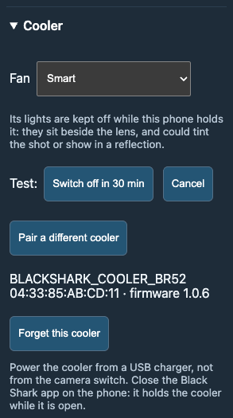

**Managed from the dashboard (experimental, in development).** The camera app finds the cooler clamped to its phone
and controls it over Bluetooth: the fan mode chosen on the phone's card, **its lights kept off** so they never show in
a shot or a reflection, and the cooler's temperature and fan speed shown beside the phone's own, with the Temperatures
page listing each cooler and the readiness check warning if one goes missing. It speaks the cooler's own Bluetooth
commands, which were worked out from Black Shark's app rather than published by Black Shark, so a firmware update could
change them; only the MagCooler 5 Pro has been tried. Close Black Shark's app while the camera app is in charge: only
one of them can hold the cooler at a time.

<br clear="right">

## System and locations

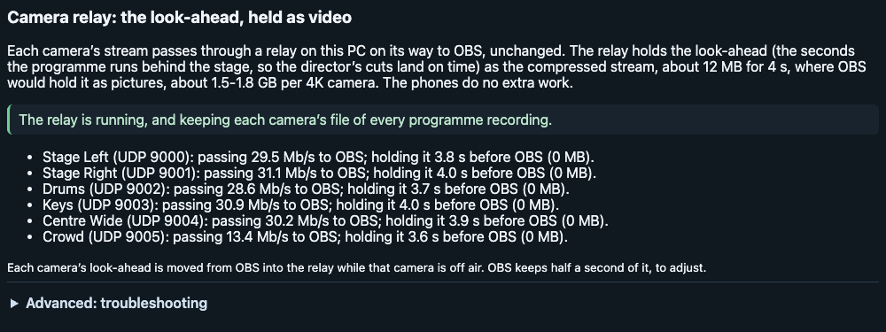

System › This PC shows the camera relay at work, the AI assistance level, manager updates and how OBS decodes each
camera. The relay can be switched off there, under *Advanced: troubleshooting*; without the SRT library it falls back
by itself to cameras streaming straight to OBS, and says why.

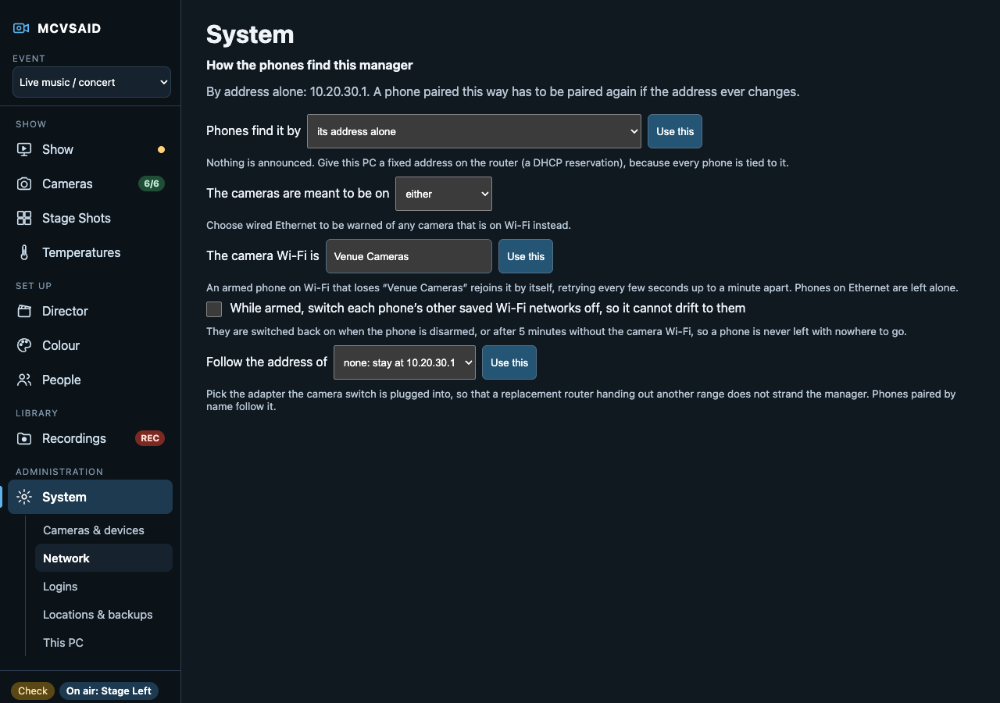

How the phones find the manager (by its address, or a name announced on the network), the camera Wi-Fi they rejoin,
an **operator** login for a tablet on the camera network with fewer powers than the administrator, everyone logged in,
and updates of the manager itself from the dashboard.

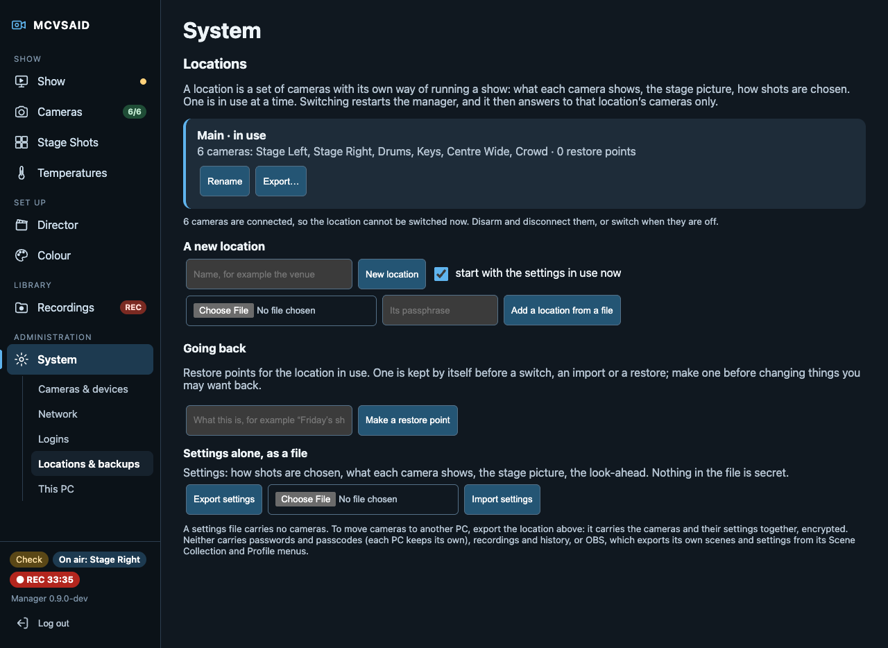

A **location** is a set of cameras with its own way of running a show. One computer can move between venues, with
restore points to go back to an earlier set-up, and a whole location can be exported (encrypted) to set up another
computer. A camera a location does not always use can be set **Not used here**, so it never holds up the readiness
check or appears in the show, a camera can be **renamed** at any time (its OBS source and scenes take the new name
too, without a cut), and one can be **removed** for good, its pairing revoked.

## On a phone or tablet

<p>
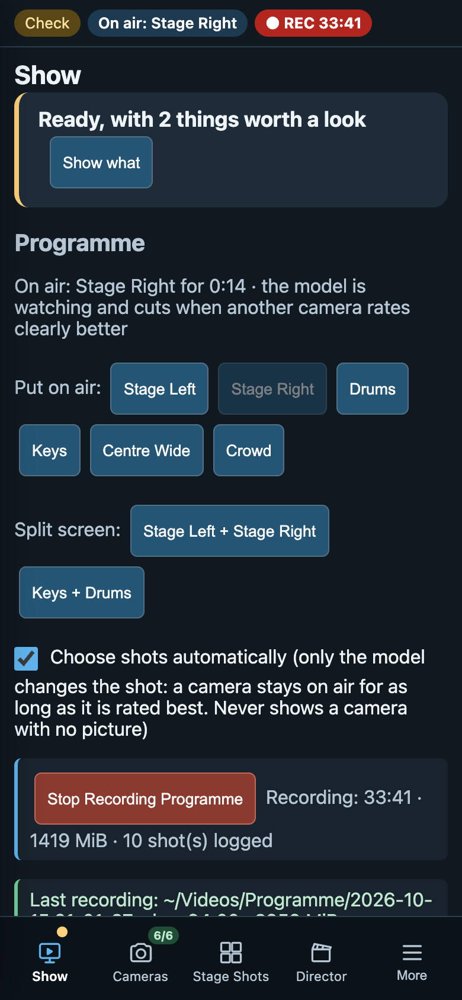
&nbsp;
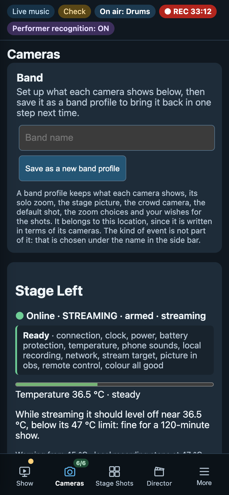
</p>

On a phone the main pages sit along the bottom, with More for the rest; a tablet gets an icon strip that opens out.

---

## The production computer

Everything but the cameras runs on one computer: OBS, the manager, the camera relay and, if used, the shot-choosing
model. It runs on **Linux or macOS**. These figures come from the two computers it has run on; check them on the one
that will run your show, with every camera streaming at its intended size for the length of a show.

| | Mac (runs it live) | Linux workstation (built on) |
| --- | --- | --- |
| **Computer** | MacBook Pro, M5 Pro (18 cores), 48 GB unified memory, macOS 26.6 | Intel i9-14900HX, 32 GB, NVIDIA RTX 4090 Laptop GPU, Linux Mint |
| **Decoding the cameras** | in hardware (VideoToolbox): six 4K cameras for 27% of one processor core | on the processor: six 4K cameras for about 16% of it (the graphics card's decoder filled up at three 4K and three 1440p) |
| **AI** | Standard (the Plus detector measured there too) | Standard |
| **Shot-choosing model** | llama.cpp natively on the Mac's graphics (Metal), Qwen3-VL 8B: about 0.6 s an answer idle, about 2.2 s to rate six cameras during a show | llama.cpp in Docker on the graphics card: about 1 s an answer |
| **Software** | OBS for macOS, Homebrew (Python 3.13, ffmpeg, SRT), launchd services | OBS (Flatpak), Python 3.12+, systemd user services |

**Memory on the Mac.** Measured with six cameras at 4K (25 Mb/s each), a 1080p programme and a 5.5 s look-ahead:

| | Camera relay off | Camera relay on |
| --- | --- | --- |
| OBS (the look-ahead held as pictures, or compressed in the relay) | 11.0 GB | 2.6 GB |
| Shot-choosing model | about 8 GB (2.4 GB of its own and 5.7 GB of weights on the graphics) | the same |
| **The whole Mac in use**, other apps included | **38.8 GB** | **30.7 GB** |

The processor was 42% busy and the graphics 65%. In use, with five cameras at 4K, the Mac's memory in use has been seen
to approach 40 GB (that reading includes OBS's canvas and recording and whatever else is open). So:

* **48 GB is recommended for five or six cameras at 4K with the shot-choosing model**, with the camera relay on (the
  default), which saved about 1.4 GB of memory per 4K camera.
* **32 GB** is enough for fewer or smaller cameras, or at No AI. The person detector for Plus adds little: about 11 ms
  a picture on the M5 Pro.
* On a Mac the video decoder's load cannot be read, soundcheck by sound needs Linux (PipeWire), and listening for
  instruments needs a loopback sound device such as BlackHole.

**Everything else**

* **Disk** for the programme (about 6 GB an hour) and, if the computer keeps each camera's stream, about 13 GB
  an hour per 4K camera (25 Mb/s), twice that until a recording's files are made. The readiness check works this out
  from the cameras' real rates.
* **A wired gigabit network adapter** on the cameras' own network: six 4K cameras are about 150 Mb/s. Phones on USB-C
  Ethernet adapters (with PoE, one cable for data and power) are steadier than on Wi-Fi at that rate. A separate
  connection is needed for streaming out.

## The camera app

* Android 8 or later; tested on Pixel 3, 4a and 8, and Galaxy S20 FE, S23 and S23+. The latest version is under
  [Releases](../../releases).
* 1080p, 1440p or 4K at 30 fps, H.264 with AAC sound, over SRT; local MP4 recording alongside, where the phone stays
  cool enough.
* Runs as the phone's device manager, so it can be armed, restarted, updated and have its clock set remotely, with the
  screen lock left on.
* White balance and exposure set from the manager; a frozen picture revived by itself; the camera Wi-Fi rejoined by
  itself; its battery held short of full while charging; silent while armed; a clamped-on cooler controlled over
  Bluetooth.
* A Hohem iSteady X3 or MT3 gimbal aimed over Bluetooth, and steered by the phone itself to follow a face or a person.
* Face blur on the phone (experimental): every face found (YuNet) and blurred before anything is recorded or sent, and
  where it blurred each frame reported to the computer, which backs it up.
* Each release here is signed with the installation's release key, and the checksum of each file is published beside
  it. New versions are built, signed and published here automatically.

## Security, briefly

* Phones and manager authenticate each other: a per-camera credential (kept on the computer only as a hash) and a
  pinned certificate.
* The dashboard is reachable from the computer itself; from the camera network only with an operator login, over HTTPS.
* Set-up codes and USB set-up hand each phone its own pairing; passwords typed for a code are not stored.
* Nothing is sent from an installation to the project: no usage reporting, crash reporting or footage.

Found a security problem? Please report it privately to **mcvsaid@proton.me**, never in a public issue.
