# MCVSAID — MultiCam Video Stream AI Director

**Turn a handful of Android phones, and network PTZ cameras that send NDI or SRT, into a multi-camera live production, kept in sync, and directed automatically.**

**[Why MCVSAID?](WHY-MCVSAID.md)** What it does that other phone multicam tools and auto-directors don't, and how it
compares. **[Try the demo](https://demo.mcvsaid.com/)**: the real dashboard with simulated cameras, in your browser.
The project's site is **[mcvsaid.com](https://mcvsaid.com)**.

MCVSAID makes ordinary Android phones into remotely managed cameras for live music and events. Each phone streams
its picture to [OBS](https://obsproject.com/) on a production computer. A manager on that computer keeps every feed in
step, watches the health of every phone, matches their colours, and can choose the shots itself with a vision model
running on the computer's own graphics. Cameras can be mounted out of reach: everything is done from a browser.
**You choose the cameras:** any recent Android phone, from a used Galaxy S23 to a phone with a 10x lens, phones on
gimbals, and network PTZ cameras that send NDI or SRT, such as a Tenveo VX30M-Ultra with 4K at 60 fps and 30x optical zoom, side
by side in one show (see [A network camera beside the phones](#a-network-camera-beside-the-phones)).

It directs **live music, church services, podcasts and talk shows, panels and conferences, theatre and comedy, and
cooking shows, and karaoke nights**, each with its own camera roles, pacing and way of choosing shots, and has a **Creator Studio** for
people recording themselves, where you define the framings yourself. And it runs at the level of **AI assistance** a
production wants: none at all, a vision model on the computer itself, or that model plus recognition of consenting
performers.

**New: a Director View camera for a PTZ.** A phone fixed right beside a network PTZ camera, showing the whole stage,
is its **Director View camera**: whoever the director wants is found in that picture, and that is the way the PTZ
should turn, however far back they stand (checked against simulated cameras, not yet a real pair). The same phone times the PTZ against
the others and gives it its colour reference: see [A network camera beside the phones](#a-network-camera-beside-the-phones).
**New: lined up before doors open.** The **Pre-show calibration check** on one phone says what is ready, lets a
**stage beacon** (a spare phone on a stand, shading softly) settle every camera's lip sync it can, and walks you to the
rest. Or press **Do what is due from the stage beacon** on the computer or a tablet, and nobody goes on stage at all:
the beacon does what it can and lists the rest (tried in tests and the demo, not yet at a show). Colours are matched by what the cameras see, a network PTZ camera's own white balance and exposure included: see
[Colour that matches from phone to phone](#colour-that-matches-from-phone-to-phone).
**Karaoke night.** Guests sign up from their phones with a QR code, the host calls up each singer, and the words
go onto a screen facing them, lit as they are sung: see [Karaoke night](#karaoke-night-sign-up-from-a-phone-sing-to-the-screen).
**A teleprompter that follows the speaker.** The script on a tablet beside the camera, at
`https://teleprompter.mcvsaid.local` with a PIN, the word being said lit as it is said, karaoke style; the recipe's
steps in Cooking, lyrics at a concert, readings at worship: see [Teleprompter](#teleprompter-the-script-on-a-tablet-lit-as-it-is-said).
**Voices that line up with mouths.** The manager keeps each camera's sound in step with its picture by itself, measured
from whatever is heard in the room while OBS is neither recording nor streaming (new, and still being tried); and
*Calibrate sync* measures it through OBS itself from a phone or tablet that flashes and beeps in front of the cameras: see
[Live music, worship, podcasts, panels, theatre, cooking](#live-music-worship-podcasts-panels-theatre-cooking).
**Recipes made for the show:** *Prep for the show* turns a long recipe into short steps the cook can call out, and you
choose when the recipe card is on screen: always, at key moments, or only when asked ("show the recipe", "hide the
recipe").
**A host's back and forth:** when a host looks into their camera the director cuts to them as they turn to it, and
back to the shot it left when they look away: see [The director](#the-director).
**Operate from a tablet:** steer gimbal cameras with an Xbox controller (tested from a tablet) or on-screen buttons, at
the aim and zoom speeds you set, from `https://operate.mcvsaid.local`: see
[Gimbals](#gimbals-aim-a-camera-or-let-it-follow-experimental).
**Keys instead of calls:** a remote control on a phone or tablet, at `https://remote.mcvsaid.local`: programmable
buttons on one page, each with an icon for what it does. One press puts a camera on air, or turns a gimbal camera to a
saved angle and zoom and then cuts to it.

**Linux or Mac.** The production computer can run Linux or macOS. It was built on a Linux workstation and now runs live
on a **MacBook Pro with an M5 Pro and 48 GB of memory**: OBS, the manager and the shot-choosing model all on the one
laptop (see [The production computer](#the-production-computer)).

This repository holds the **signed builds of the camera app**, under [Releases](../../releases). A phone being set up
fetches the app from here; the app does nothing by itself until it is paired with an MCVSAID manager.

> The screenshots below are from a demonstration manager with six made-up cameras and drawn pictures, not a real show.

### Join the beta

MCVSAID is in a **private beta**. If you are interested in filming live events with phones (a church, a theatre, a school, a venue, a band,
a podcast or a kitchen) and would like to try it, email **beta@mcvsaid.com** with:

* what you film, and how often;
* the computer you would run it on (Mac or Linux, and its memory);
* the phones you could set aside for it, and your network.

Testers get the manager from a private repository, a tester guide, and a direct line for feedback. Camera phones must
be **dedicated phones, factory-reset and used for nothing else**: the app becomes each phone's device owner.

---

## How it fits together

```
 Android phones (camera app)                    Production computer (Linux or Mac)
 ┌──────────────┐  picture + sound (SRT)   ┌──────────────────────────────────┐
 │ Stage Left   │ ───────────────────────▶ │ camera relay: keeps each stream  │
 │ Stage Right  │                          ├──────────────────────────────────┤
 │ Drums  …     │                          │ OBS: one source per camera,      │──▶ recording,
 │              │  control (TLS, pinned)   │ full-screen and split scenes     │    live stream
 │              │ ◀──────────────────────▶ ├──────────────────────────────────┤
 └──────────────┘                          │ MCVSAID manager                  │◀── browser on the
                                           │  · readiness and health          │    computer, a tablet,
                                           │  · feed alignment                │    or a phone
                                           │  · shot choosing (by hand or AI) │
                                           │  · colour matching               │
                                           │  · recordings                    │
                                           ├──────────────────────────────────┤
                                           │ vision model, person detector    │
                                           │ (optional, on this computer)     │
                                           └──────────────────────────────────┘
```

* Each phone streams over **SRT**. It can also record its own full-quality copy, if it stays cool enough doing both;
  the production computer can instead keep every camera's stream itself, as it arrives.
* Every picture carries a small **timing strip**, which the manager reads to line all the feeds up to the frame; OBS
  never shows it.
* The **camera relay**, on by default, holds the look-ahead as compressed video rather than OBS holding it as pictures:
  six 4K cameras took OBS from 11.0 GB of memory to 2.6 GB. It can also keep each camera's own file of a recording.
* The control connection is **encrypted and pinned** to the manager's certificate. Phones find the manager by its
  address or by a name on the local network.
* Each camera's **stream is encrypted** with a passphrase of its own, which the manager hands to its phone over that
  connection: only the paired phone can send a camera's picture, and nobody else on the network can watch it.

---

## The show at a glance

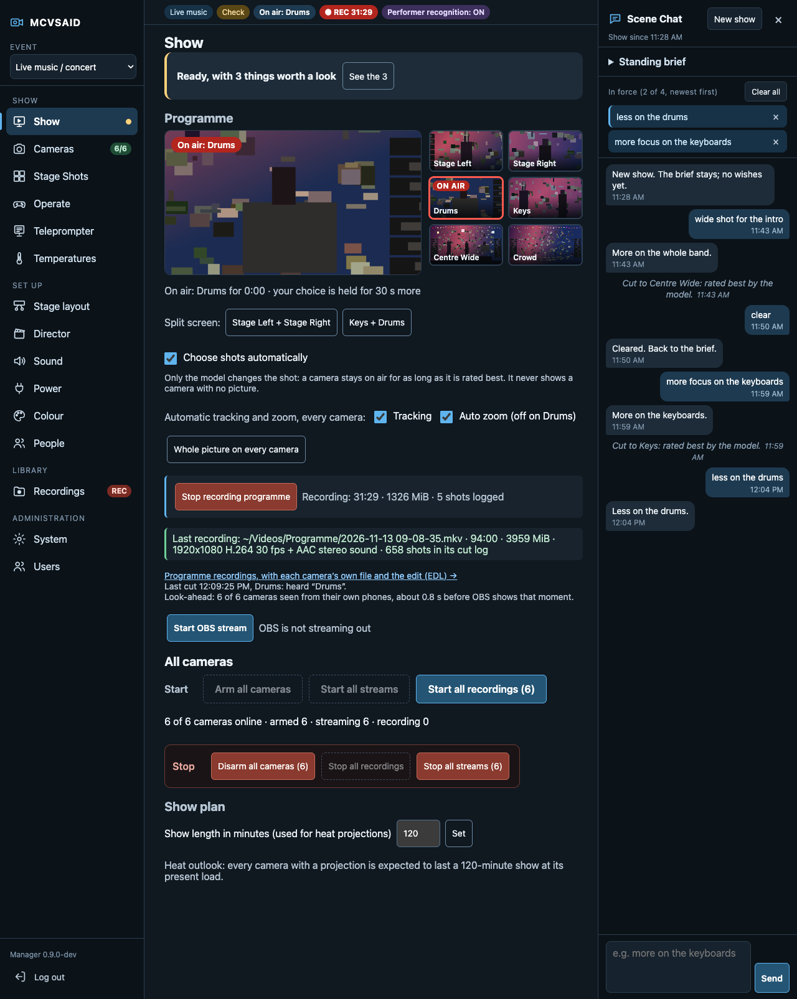

The dashboard is grouped by when things are needed: **Show** (Show, Recipe in Cooking, Karaoke at karaoke night, Cameras, Operate, Teleprompter,
Stage Shots, Temperatures), **Set up** (Stage layout, Director, Sound, Colour, People), **Library** (Recordings) and **Administration** (System).
The show's state (ready, on air, recording) stays in view at the foot of the side bar.
If the manager stops answering, a banner says so and the state is greyed, so the page never passes old news off as current.

One line answers the question that matters before doors open: **is everything ready?** It is worked out continuously
from the computer (OBS, memory, processor, recording space, the camera network, the relay, the model) and from every
camera (connection, clock, power, temperature, Wi-Fi, stream target, picture in OBS, frame rate, colour, sounds, its
cooler), and names what
needs attention, with what to do about it. Below it: the programme, what is on air, any camera or split screen one press
away, recording and streaming, starting and stopping every camera at once, and a heat outlook for the length of the
show.

## Live music, worship, podcasts, panels, theatre, cooking

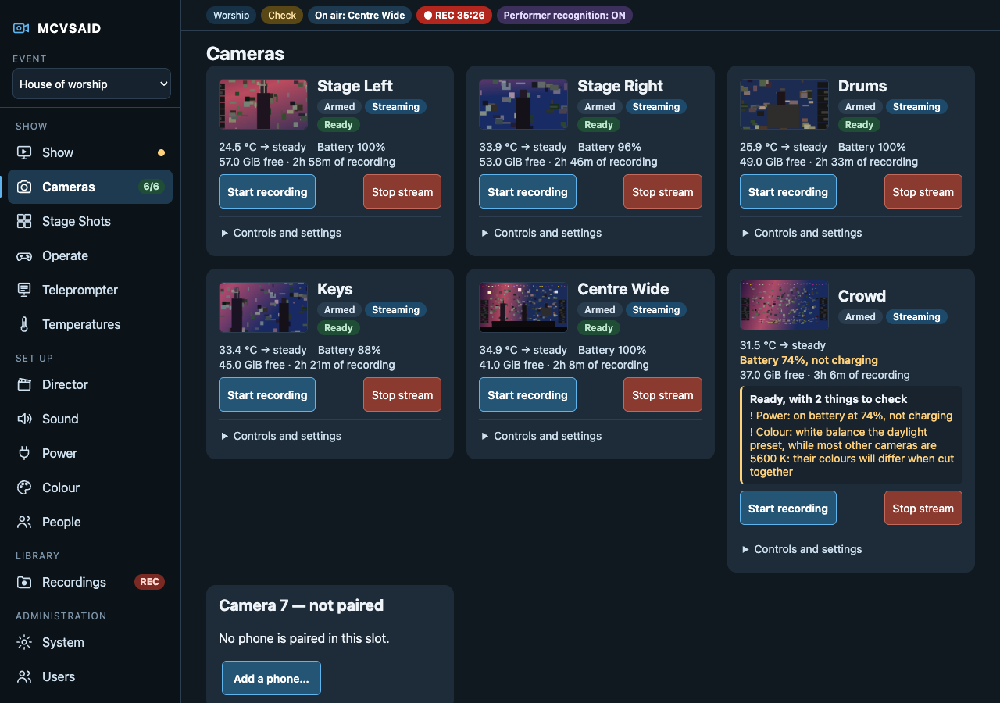

The kind of event is chosen at the top of the side bar. Each kind offers its own roles for what a camera shows (a
pastor, a reader, the choir and the congregation for a service; a host and guests for a podcast; a moderator and
panelists; a performer and the house for theatre), uses its own words with the shot-choosing model, and keeps its own
pace. For podcasts, panels and services, with each microphone on its own channel of a mixer, the director **switches to
whoever is talking**, allowing for bleed between mics, coughs and pauses; laughter and applause bring in the audience
camera.

**Cooking** treats the food as the star as much as the cook: the board while hands cut, the stovetop while something is
in the pan, the oven while its door is open, the plate at the end, with the kitchen's own sounds pointing to the busy
station. Load a recipe from a web page or pasted text on its own **Recipe** page and the director follows its
preparation and steps, makes sure each step's key station is seen, marks the steps in the recording, and can show the
recipe, a QR code to it and step captions in OBS: always, at moments (after Record starts, as each step begins, at the
end) or only when asked, with each step's details in its pop-up if you like, in time with the programme. Every step is
listed with its time and key shots; go to any step, mark it done or skipped, and undo; **Edit steps** lets you change,
add, delete and drag steps into order, before or during the show, and **Edit as text** opens the whole recipe,
ingredients and equipment too. **Prep for the show** turns long steps into short ones the cook can call out, one action
each ("grind the beans"), keeping the full wording as each step's details, checks that a camera covers every step, and
lists what to say for each, to rehearse. With spoken cues on (Standard or Plus AI), the cook says "let's see that
recipe" (and "hide the recipe"), "step two", or a step in the recipe's words or their own ("let's make the sauce"),
forward or back, or calls out an ingredient,
and the recipe, the step or the ingredient's line goes on screen while the AI keeps directing the shots; speech is
recognised on the production computer and nothing heard is kept. Pressing Record starts the recipe afresh, and it
moves on by itself only while recording. The host can walk through it from their own tablet on the counter too: at
`https://recipe.mcvsaid.local`, one step at a time in big type, the ingredients to tick off, timers for the times a step
names, and Next and Back that move the director along, with buttons to show or hide the recipe on screen and pop the
step's name up. When recording starts it brings up the ingredients first, ticks each as the host names it, and then
moves on to the preparation and the first step; or as a prompter, the step alone in the biggest type, following as the host calls the steps out. A red
REC says the show is being recorded, and an operator can start and stop the recording from there. In the kitchen the
director puts two cameras side by side only when both show the step being cooked and something is happening in each,
and never for long: no more half a screen of crackers waiting while the pot boils.

**Explain the director, on the video.** For demo videos, switch on *Explain the director* and the programme carries
caption cards saying what the AI did and why: each cut and who made it, a solo heard, a gimbal tracking someone or turning to the soloist, a
lens change, a voice call, and now and then a feature in use. They are recorded with the programme, so the video shows
how it was made. Performers are never named.
Each card comes up as the programme shows the moment it explains, and in Cooking they keep to the corner away from the
recipe.

**Look back to bring the camera back.** With gaze on, a cook who called "cut to the stove" brings the shot back to
themselves just by looking into the front camera: a new look ends the called shot's hold, once it has run a few seconds.
After a short look into a camera, looking away goes back to the shot before, unless the camera they looked into is
still the best picture (they are still talking, or looking down at the work). With a host, the gaze is quicker: it cuts
to them just before they turn to the camera, and a glance away no longer cuts away and straight back. The recipe's own
key shots wait for the host too.

**The programme's sound levelled by itself.** A phone across a room hears a voice quietly. Switched on, the manager
turns each camera heard in the programme up (or down) in OBS until its loud moments peak near a set level: slowly,
not while nothing is heard, and with a limiter to catch the peaks.

**Programme sound from one camera.** Every phone's microphone can be in the programme; choose the one that leads, and
the others join it only while they are lined up with it, measured from the cameras' own streams, so nothing echoes. Or
let it **follow the speaker**, opening only the microphone that hears them best. New, and still being tried: the
**programme mix** keeps every phone's microphone in time with the leading one (each phone's clock runs a little
fast or slow) and mixes them as one sound. **Lip sync** moves the sound against
the picture, and **Calibrate sync** measures it for you: a phone or tablet flashes and beeps in front of the cameras,
OBS records a few seconds of the programme, and each camera's sound is measured against its own picture and set to
match, even a second and a half out. New, and still being tried: the manager also **measures it by itself, with no
flashes**, from talking or music in the room, a phone by its timing strip and a network camera by its own stream,
and sets it only when the measure is sure. They are on the **Sound** page, with the voice calls. New, and not yet
tried on real cameras: a **stage beacon**, a spare phone left on a stand facing the cameras, lets the manager check
every camera's lip sync by itself, even during a show: its screen shades softly and it hisses quietly for twenty
seconds, a gentle "shhh" that swells in and dies away, nothing like a flash or a beep, and nothing goes on air. The
same soft shading keeps a network (NDI) camera in time with the phones: every quarter of an hour, in a show too, the
manager finds it in both pictures and holds the network camera so the two show the same moment together. In between,
the times stamped on the network camera's own NDI frames keep it there (new, and not yet tried through a show): the
manager follows any change in its network's delay from one timing to the next, and its card says so. The
beacon phones are managed from the dashboard: made a beacon or a camera again, tested, and watched for battery and heat.
Put the beacon on the room map and it can set a camera's lip sync from nothing, too, allowing for how far away it is.
And with the programme mix it can set the mix's own timing before the show, with nobody back on stage: for about
half a minute one camera is put on air and OBS records, then everything is put back (new, and not yet tried on real
hardware).

**Voice shot calls.** In Cooking and Creator Studio the host can call a shot aloud: "cut to the overhead", "show the
stove", "wide shot". The director cuts to that camera just as the call reaches the programme, together with any zoom
asked for, and holds it before choosing again by itself. Each camera
answers to its name, what it shows and phrases you give it, after a call word ("cut to", "let's take a look at",
or words of your own for each kind of event); a name in passing, a question or "don't cut to the stove"
does nothing, a call only a phone heard waits for the computer to hear it too, and two cameras called in one breath
cut to neither. Off by default where music, a congregation or several talkers could call cameras by mistake, and
switched on or off for each kind of event on the Sound page.

**Voice zoom calls.** "Close up", "zoom in", "pull back": the camera on air zooms, gliding on the phone and handing over to
its telephoto on the way, and the director holds the shot. A band can give it a cue of its own that nobody sings ("camera,
close on me") for a performer to call a tighter shot themselves. Your own phrases are caught by a quick phrase spotter
the moment you finish saying them, a fifth of a second or so, with Whisper hearing everything else.

**"Show the pot."** Aim a gimbal camera at the pot, zoom in and press **Save as target** on its card. Then "show the pot"
swings it there and zooms, going on air once it has arrived so the swing isn't seen, and "back to me" puts it back as it
was, following you again. Each kind of event keeps its own targets, with other words for each if you like. Walked
somewhere else? Say "and remember where we are" first, and "let's bring it back" returns there after the pot instead;
"let's bring it back home" sends it to the home position you set.

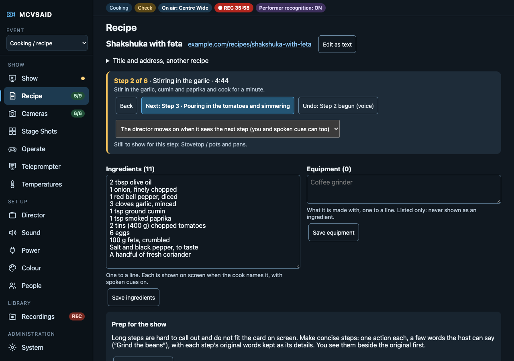

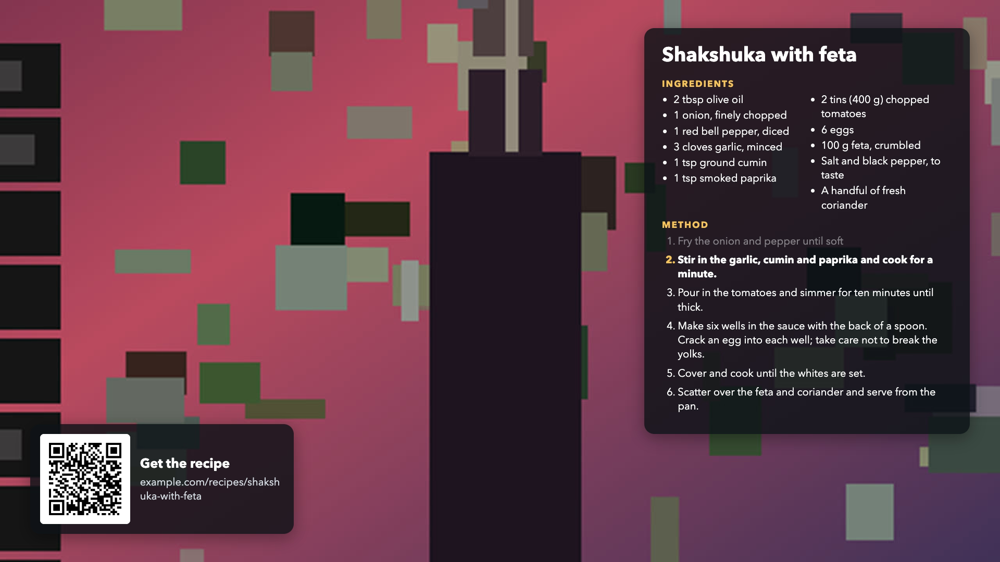

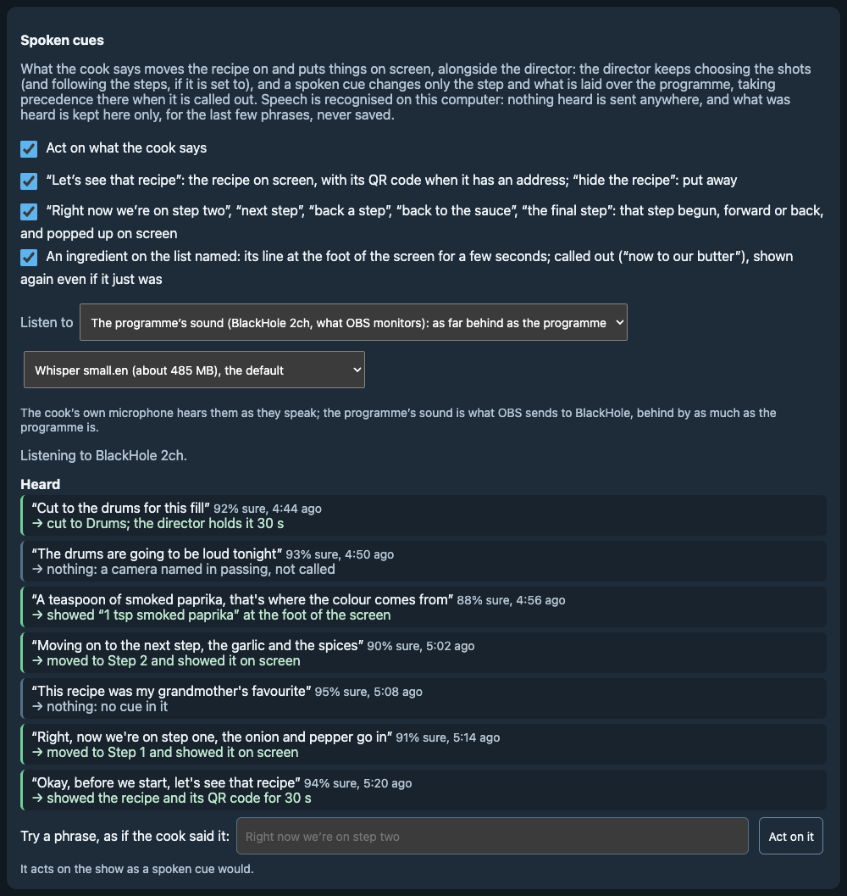

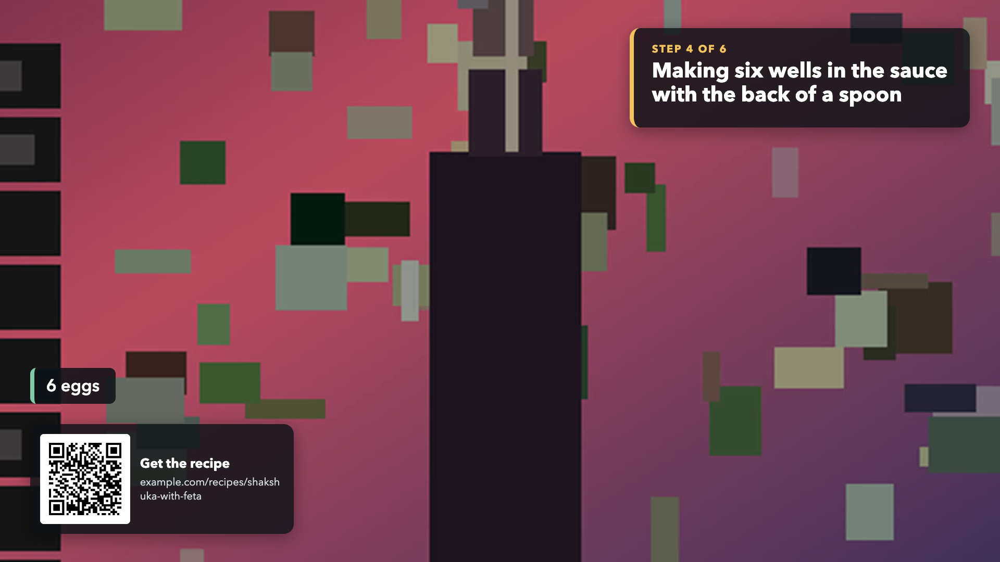

**Creator Studio** is for one or a few people recording themselves, and nothing in it is preset: build your own
framings from body regions (head, shoulders, hands, hips, knees, feet), choose how close each camera shoots and when it
cuts. Switch a camera's framing from its card or the Operate page, or just say it: "give me the hands", and that camera
shows the hands alone, turning to them on a gimbal. It needs
Plus AI's person detector and a body keypoint model, both run on the computer.

## Every camera, in detail

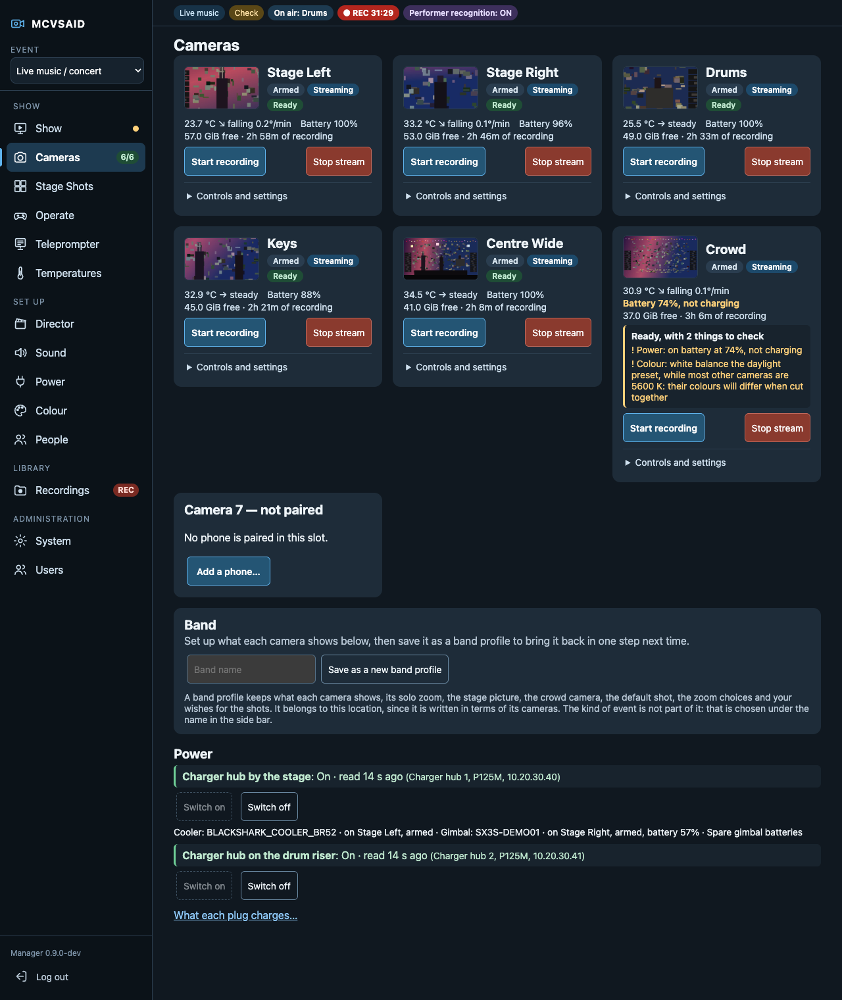

Each camera has a card: online and streaming, a readiness summary, temperature with its trend and a forecast, battery,
network, free space, and its controls. The rest folds away until needed. **Band profiles** save who stands where, so
the same band on the same stage is set up in one step.

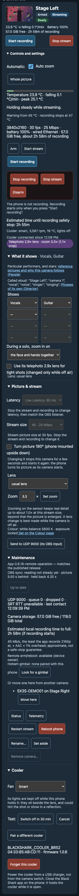

Opened out, a card sets which performers or instruments the camera shows (up to eight), where to zoom during a solo,
whether the director may use its **telephoto lens**, the stream size and latency, the lens and **sensor zoom**, its
cooler where it has one, and its app version and maintenance: all from the computer, while the phone stays on its mount. Clocks are set
automatically, and app updates roll out one unarmed camera at a time.

<br clear="right">

## Stage Shots

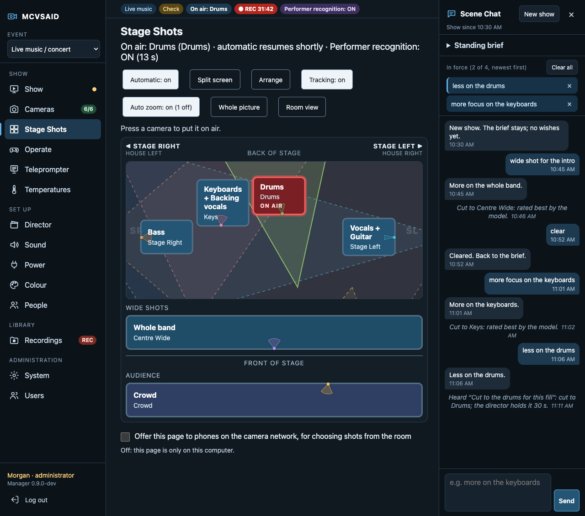

The cameras laid out as they stand on the stage, by what they show, read from the back of the stage to the audience,
with stage left and right as the performers have them. Press one to put it on air, or pick two for a split screen.
A tight shot is a narrow button and the whole band a wide one, and a mark on each shows where its camera stands,
which way it points and how wide it sees, and the room map's wedges are drawn across the stage behind the buttons.
**Room view** puts the buttons on the room map's stage, among the cameras that film them.
The page can be offered to phones on the camera network, behind its own passcode, so someone in the crowd can call the
shots by hand, at `https://stageshots.mcvsaid.local` with no port to type.

## Stage layout

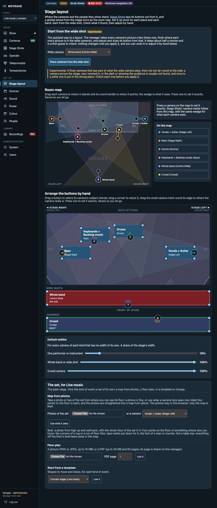

Where the cameras and the performers stand is set up once, on one page under **Set up**, and Stage Shots is laid out
from it. Start with one button: experimentally, **Place cameras from the wide shot** finds each
camera's picture inside the wide camera's and offers where its button should go: on the performer it shows, with the
person detector. With a vision model it also suggests who that is, and asks "guitar or bass?" when it cannot tell.
It is a first guess to check: nothing changes until you apply it, and you can undo it.
Below it, a **room map** from above places and turns each
camera and shows the wedge it sees, worked out from its lens and zoom, and the buttons can be moved and sized by hand.
Expand the map over the whole window and the chosen camera's own picture sits beside it: press the stage's corners in
the picture and the manager works out where that camera stands, how high, which way it points and how far it tilts,
offered on the map to take or leave. A camera given a height and a tilt is drawn by what it really sees of the floor,
with a side view of it against a performer.
Each kind of event can have **a set of its own** under the
map: take a photo or two of the set with any phone, press four points on the floor round something you know the size
of, and it is straightened into a map from above, to scale (or measure the set with a camera phone's AR, which marks
its corners in metres and needs nothing pressed: new, and not yet tried on the phones); or give a floor plan (a picture or a PDF), or start from a
template (a kitchen's counter, stove and prep table, a podcast table with its microphones) and move the shapes.

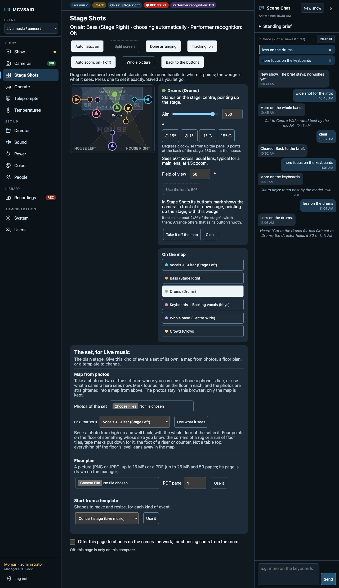

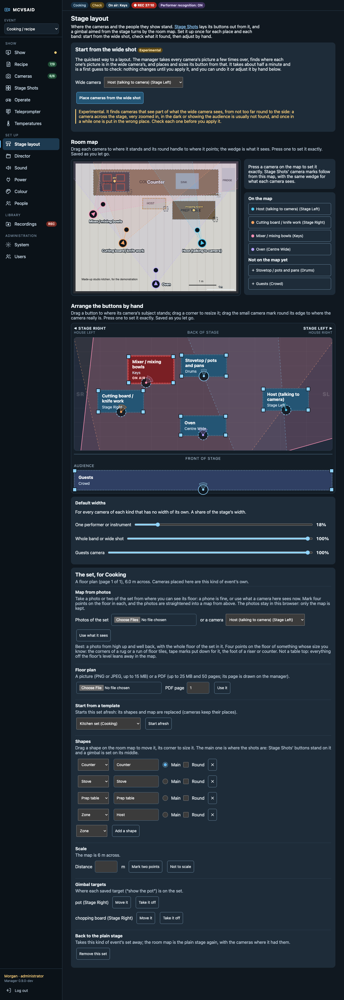

## Temperatures, run by run

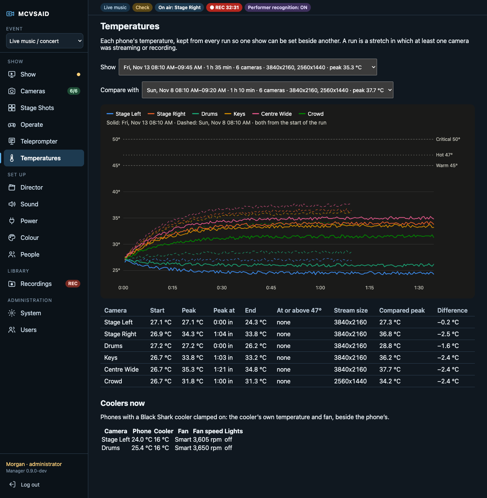

Every phone's temperature is kept from every run, so one show can be set beside another: which camera ran hottest, how
long it took to settle, and whether a change of mount or picture size helped. Phones with a cooler clamped on have it
listed beside them: the cooler's own temperature, its fan and its lights. (In the demonstration, Stage Left and Drums
have one.)

## AI assistance: none, Standard or Plus

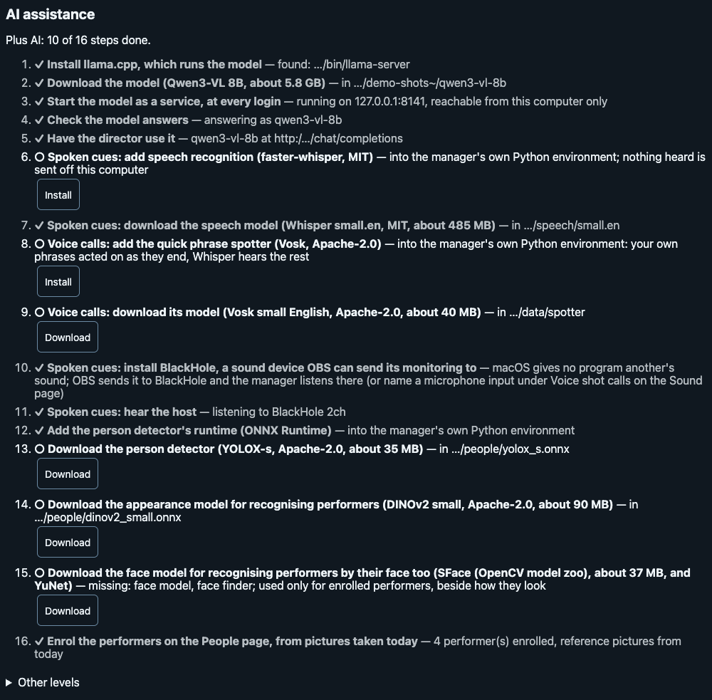

How much AI helps is a choice for each installation, so a modest computer can still run a show:

| Level | What it does | What it needs |
| --- | --- | --- |
| **No AI** (the default) | Shots by hand, from Stage Shots, by timed rotation, or switched to whoever is talking; the safety rules still cut away from a camera that fails | Nothing extra: no model is downloaded or run |
| **Standard** | A vision model on the computer rates every camera, zooms in on and follows a performer, listens for the instrument to the fore, and can cut to the camera a performer looks at | About 7 GB of graphics memory: an Apple silicon Mac with 32 GB or more, or an NVIDIA card with 8 GB or more |
| **Plus** | Standard, and consenting performers recognised: stars given priority on any camera, cameras that follow a named performer, framed ten times a second by a fast person detector | Standard's, and a small person detector (YOLOX-s) |

Choosing a level shows its set-up as steps, each checked live: a button for what the manager can do itself (download
the model, run it as a service on the computer only, point the director at it, add the detector), and a ready-to-copy
command for what needs an administrator's password. It also says honestly whether a level fits the computer. Listening
for instruments has its own steps, down to the OBS settings that let the manager hear the programme.

On the Director page this is a single line (for example "Plus AI: 10 of 16 steps done") with a button to continue; the steps
sit in a fold, closed until you open it. The screenshot above shows the steps unfolded.

## The director

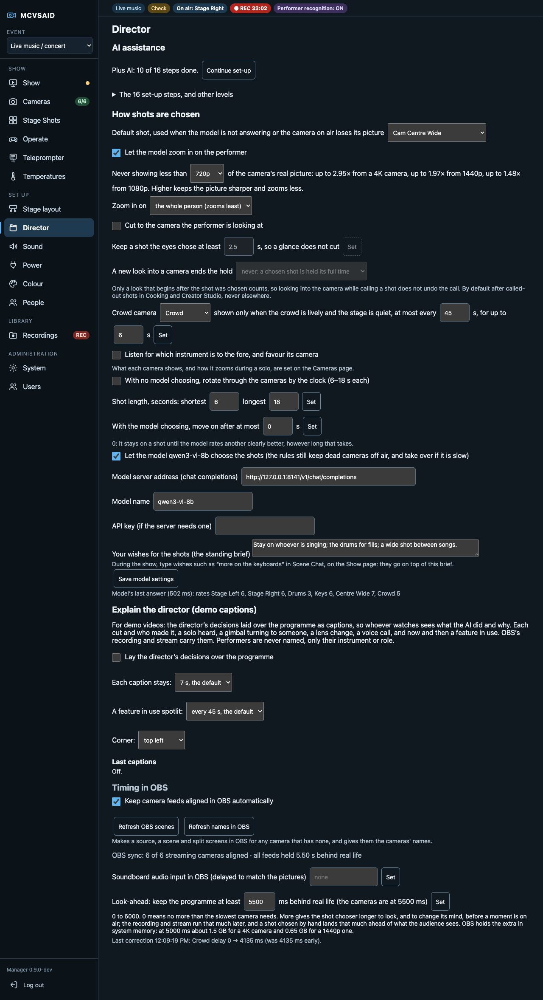

Shots are chosen by a **vision model** running locally (any OpenAI-compatible server; llama.cpp with Qwen3-VL 8B here),
guided by plain-language wishes ("stay on whoever is singing; the drums for fills"). A **look-ahead** holds the
programme a few seconds behind real life, so the model sees each moment in the phones' own pictures before it airs and
every cut lands cleanly. The director can also:

* **zoom in on a performer and follow them**, leading a walker with room ahead, and never zooming in on nobody: empty
  pictures, boxes no person could fill and scenery the model keeps mistaking for a person are all refused;
* use a camera's **telephoto lens** for tight shots, changing lens only while that camera is off air;
* **cut to the camera the performer is looking at** (on a Mac, with Apple's Vision framework; off unless chosen);
* **listen** to the programme sound to favour the camera on the instrument that is to the fore;
* show the **crowd camera** when the crowd is lively and the stage is quiet.

Without a model it can rotate through the cameras on a timer, or leave the choice to a person.

### Scene Chat: guiding the director through the show

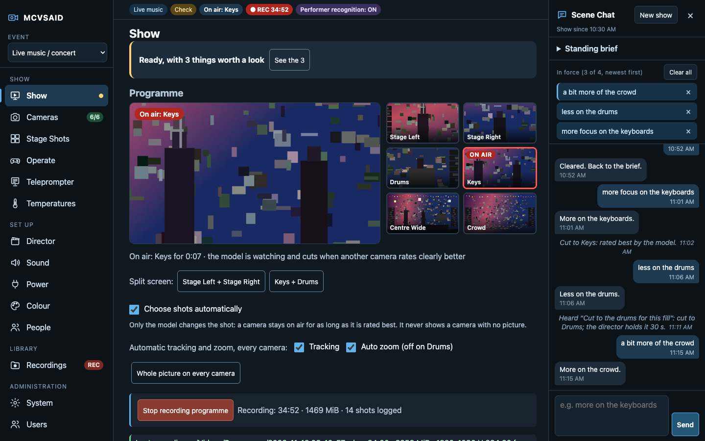

Down the right of the Show and Stage Shots pages, **Scene Chat** feels like talking to the director. A **standing
brief** says what holds all show; during it, type wishes as they come ("more focus on the keyboards", "less on the
drums") and they go on top of the brief, newest first, for the model's next look. The director answers each at once
("More on the keyboards.") with a canned reply, so the chat never costs the model any time, and notes what came of it
("Cut to Keys: rated best by the model."). A newer wish about the same thing replaces the older, four at most are in
force, each lasts 15 minutes unless cleared, and "clear" goes back to the brief. **Again**, under a wish you sent
earlier, sends it once more without retyping. And when you want two cameras side by side now, not when the model
agrees, type "split Keys and Drum Cam": that one is a command, and the split is on air at once. A pair you want side by side
whenever both are worth showing can be ticked under **Favoured split screens** on the Director page. On a tablet it opens over the page,
on a phone it is a sheet from the bottom; it needs Standard or Plus AI, and keeps the show's chat until New show.

### Search: find the button, or ask how

Nobody remembers where every setting lives. **Search**, at the top of the side bar on every page (or press `/`), takes
what you are looking for in your own words: "record the programme", "pair a gimbal", "shot length". It opens the page
the thing is on, scrolls to it and outlines it. It searches the guide too, to read without leaving the page. And with
Standard or Plus AI you can simply ask ("How do I add a phone?"): the model on your own computer answers from the
guide, with the parts it used a press away. While the programme is on air the guide's own words are shown instead, so
the director's model is never kept waiting; nothing asked is kept, and nothing leaves the computer.

## People: consenting performers, and nobody else

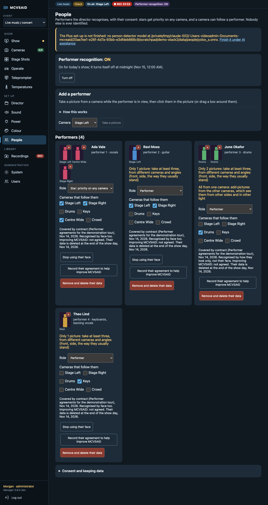

At Plus, performers who have agreed can be enrolled on the day: take a picture from a camera, click the performer the
detector outlines, and give a name, a role (a **star** gets priority on any camera) and the cameras that **follow
them**. Reference pictures are taken in what they will perform in.

* **Consent per purpose**: being recognised during the show, and, separately and optionally, helping improve MCVSAID.
  One tick confirms a performer's signed release, or the production says once that releases are handled by contract.
* **Nobody else is identified.** The director only ever recognises enrolled performers, and never zooms in on someone it
  does not recognise.
* **Faces only with their own consent.** Where a performer's release covers their face, a clear face is used beside
  how they look; otherwise only their appearance is.
* **Kept briefly and encrypted**: a small thumbnail and appearance (and, where agreed, face) descriptors, deleted
  at the end of the show day unless the production chooses longer, and at once on removal or "Delete all performer data". Logs say "performer 2",
  never a name. Pictures kept to improve MCVSAID are pseudonymised, with everyone else in them blurred.
* **Faces, only with their own consent.** Where a performer's release covers their face, a clear face is used beside
  how they look, and outweighs a matching costume.
* While recognition is on, every page says so.

The people in this screenshot are made up, and their pictures are drawn figures.

## Face blur (experimental)

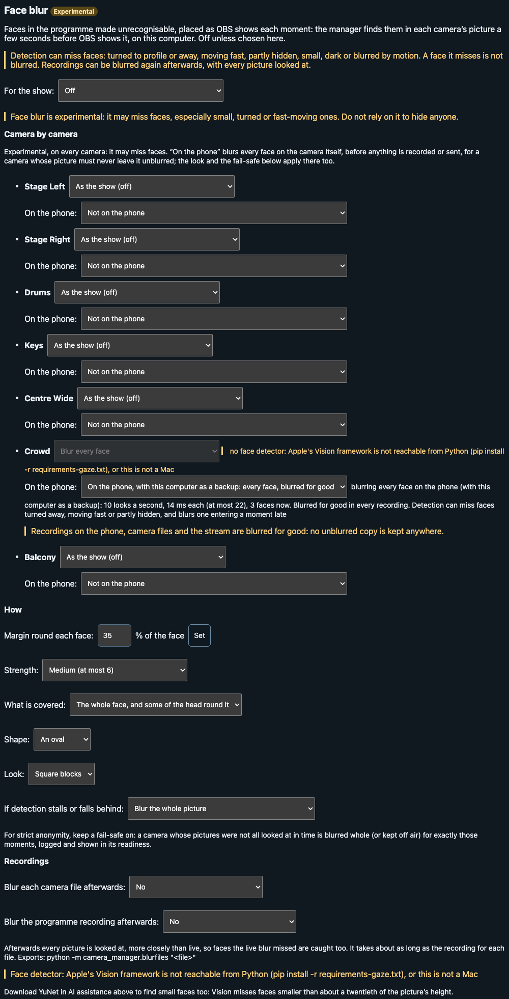

**On the phone first.** A camera whose picture must never leave it unblurred can blur every face **on the phone
itself**, before anything is recorded or sent: its stream, OBS, the computer's copy and the phone's own recording are
all blurred for good, and no unblurred copy exists anywhere. The phones now find faces with the same detector as the
computer (YuNet), which finds turned and small faces too: on test scenes it found 78–84% of faces, against 31–38% for
the phones' earlier detector.

**The computer as a backup.** With *On the phone, with this computer as a backup*, the production computer keeps
watching that camera a few seconds ahead of the programme and covers in OBS any face the phone left showing: one
walking in before the phone has looked, or one it lost for a moment. The phone reports where it blurred each frame,
so the computer knows which faces it already covered and adds only what was missed. If the phone's own looks stop, it
blurs its whole picture.

**On the computer alone**, faces are blurred live in OBS for the whole show or camera by camera: every face, everyone
except consenting performers, or only chosen performers, covered before OBS shows them, with a fail-safe that blurs a
camera whole if its pictures were not all looked at in time. Recordings can be blurred again afterwards, every picture
looked at more closely.

**It is experimental and can miss faces**, especially small, turned or fast-moving ones, so it is hidden and off until
an administrator switches it on, and it should not be relied on to hide anyone.

<br clear="right">

## Colour that matches from phone to phone

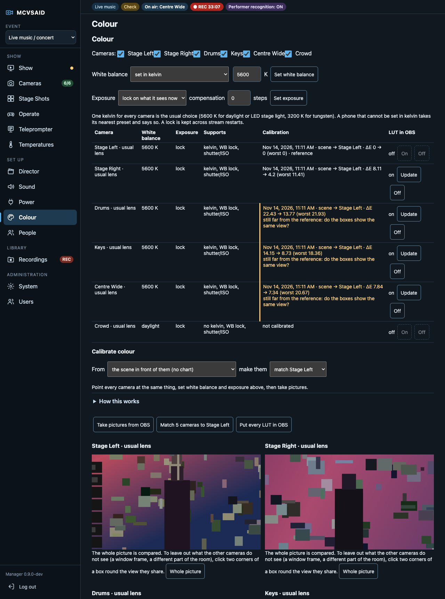

Phones of different makes see the same stage differently. From one page, every phone is set to the same **white
balance** (in kelvin, where the phone allows it, or its nearest preset) and its **exposure locked**, and each camera
gets a correction **LUT** in OBS: fitted from a colour chart, or by matching every camera to one of them on the scene
in front of them, no chart needed. The LUTs go with each recording's camera files, for the edit. No chart to hand? Open
`https://calibrate.mcvsaid.local` on a tablet: its **colour card** shows a 24-patch chart, an 18% grey, a grey scale
and colour bars, and its **sync flash** is the one Calibrate sync uses.

**One person calibrates from the stage.** Give whoever sets up a **setup tech** account: it opens Set up ›
**Calibrate**, and the Operate page's gimbal positions, and nothing else. They walk on stage with a phone, log in on the calibrate page and hold it up. **Calibrate
sound** flashes and beeps while the manager measures every camera's lip sync; **Calibrate colour** shows a chart that
the manager finds in every camera by itself (no clicking corners), fits each camera's colours and puts the corrections
in OBS; a network PTZ camera's own white balance and exposure are brought to the phones' first, on the same chart,
once that is allowed for it. With a network camera, **Time the network cameras** flashes while the manager times it against the phones by
the flashes both see. The Calibrate page at the PC follows along. A run left half-way (the page closed, the phone
put away) is picked up where it was or ended from the phone, and never keeps the next one from starting.

**Before the show, one list says what is lined up.** The same page gathers what the manager already knows and says of
each thing that it is ready, needs doing (and what to do) or cannot be told: each camera's lip sync and whether
anything has moved it since it was measured (the manager measures it again by itself from the room's sound, or at a button), the programme measured since its sound was last changed, the programme
mix's timing, each network camera timed against a phone and its input volume, each camera's colour match and whether
its white balance, its exposure or the light on the stage changed since, whether OBS has each camera's sound with its picture, the camera relay on the manager's release, and any camera that dropped its connection in the last hour, with the reason it gave. On the phone, the **Pre-show
calibration check** offers the stage beacon first when one stands ready: it sets each camera's lip sync and times a
network camera from where it stands, so that you walk only to the cameras it leaves, then takes you from camera to camera: hold the phone in front of each one and tap, and the manager puts that
camera on air with its own microphone and sets its lip sync; a network camera with a Director View camera is timed
at that phone's stop. When the cameras' colours need matching they are matched by what the cameras see (a network
camera's own white balance and exposure brought to the phone's first), and each is
shown on the phone beside the one it is matched to, to keep or leave; it ends by asking where the
programme's sound should come from: one camera, or every microphone joined in time.

## Recordings

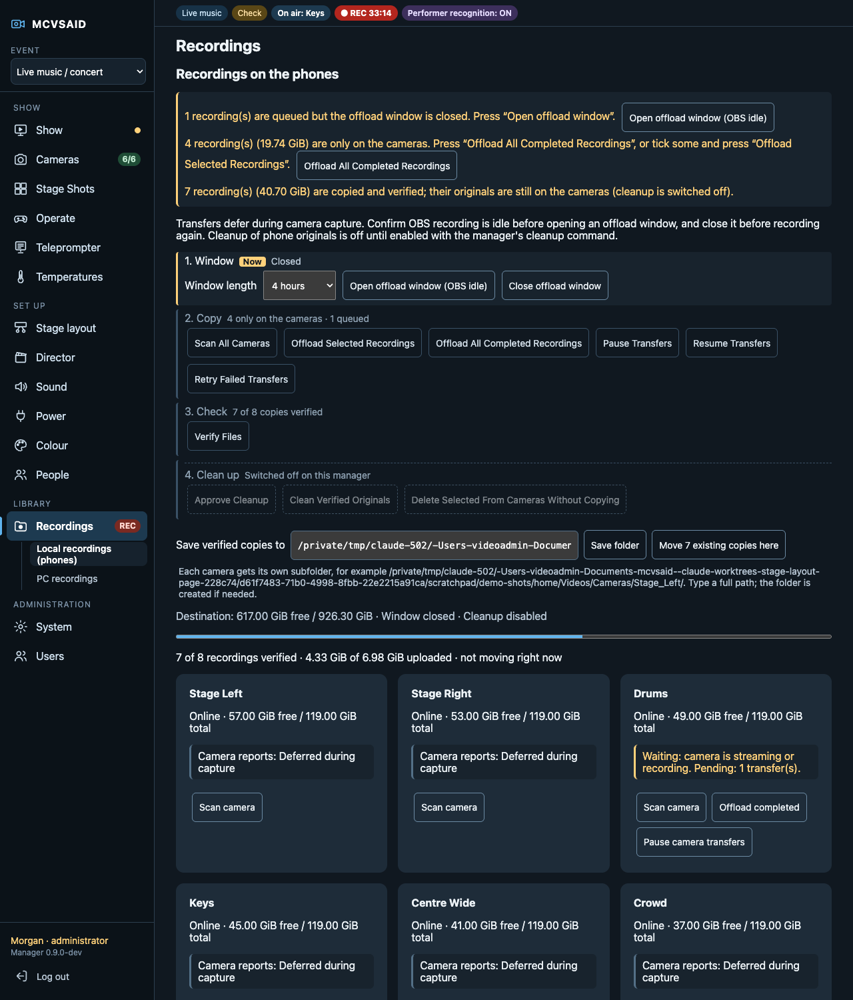

**On the phones.** Each phone can record its own full-quality copy while it streams, and the copies are taken to the
computer over the network after the show, verified, and filed by camera. Phones' copies are only ever cleared when that
is explicitly switched on. Recording and streaming together makes a phone work harder and run hotter: in testing it ran
some phones too hot to use, so **test it on the intended phones**, at the intended picture size, for the full length of
a show. A clamped-on phone cooler changes that: see [Phone coolers](#phone-coolers-experimental).
The page walks through it in four steps (window, copy, check, clean up) with the one to do now marked, and each
notice at the top carries the button it names.

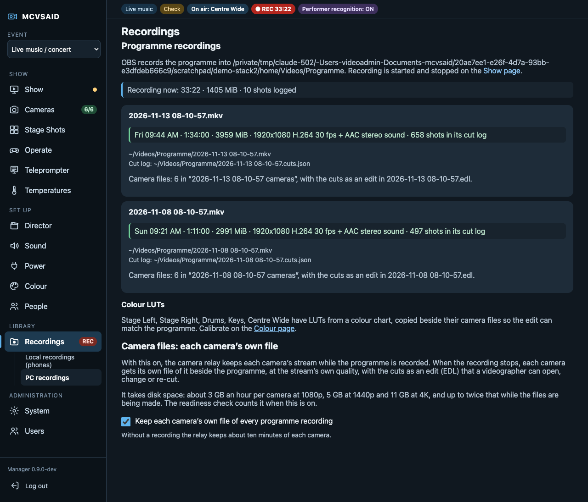

**On the computer.** The production computer can keep every camera's stream as it arrives (camera files, through the
camera relay), at no cost to the phones. Each programme recording then comes with one file per camera, the cuts as an edit (EDL) a
videographer can open in Resolve, Premiere or Final Cut and re-cut, and each camera's colour LUT. A network camera
has its file too: the relay keeps the stream the camera itself serves, untouched. Camera files are a
setting of their own, off until chosen, since they take disk space.
**Record** and **Stop** wait for the programme, which runs a few seconds behind, so the file starts and ends with what
was happening as they were pressed, and recipe steps are marked where the file shows them.

## Adding a phone

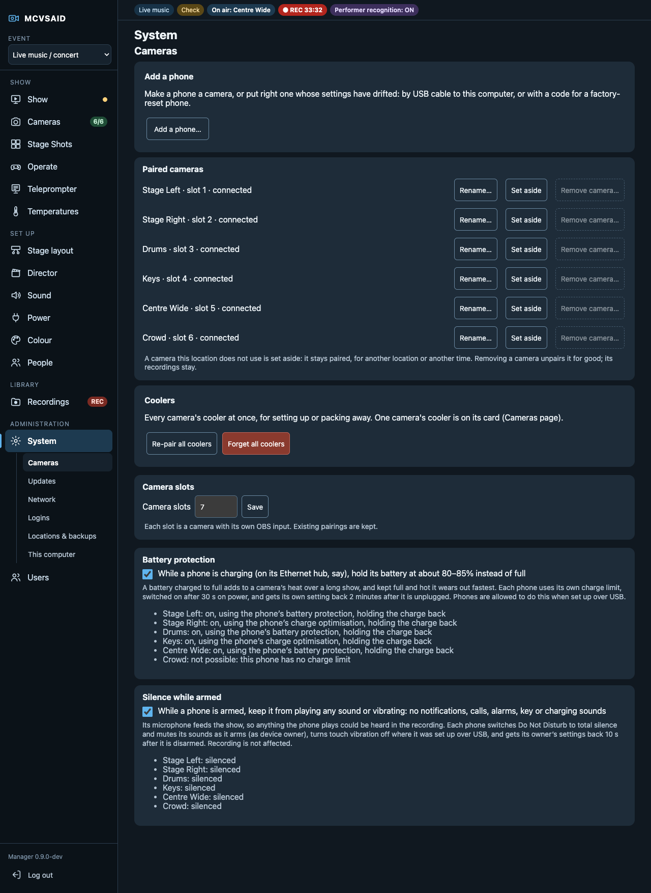

Plug a phone in by USB and the manager installs the app, grants its permissions, makes it the phone's manager (so it
can be armed, restarted and updated remotely), exempts it from battery saving and pairs it: each step checked first and
skipped when already done, so the same page repairs a phone whose settings have drifted.

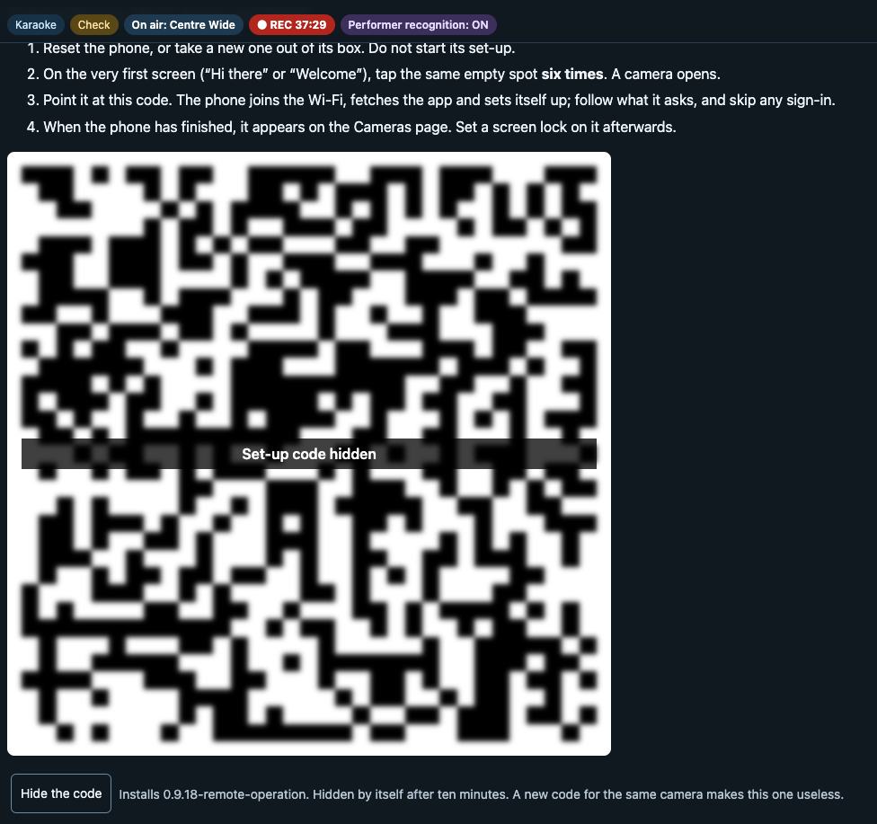

**No cable at all:** a factory-reset phone taps its welcome screen six times and scans a code. It joins the Wi-Fi,
downloads the app from this repository, checks it is signed with the installation's key, sets itself up, moves to the
camera network and connects. The code carries everything the phone needs; the manager keeps none of its secrets.

<br clear="right">

## A network camera beside the phones

A camera that is not a phone, such as a PTZ camera on the network, can be one of the show's cameras. OBS takes its
picture over **NDI**; the manager knows it by a name, a slot and the NDI source it sends, and lists the NDI sources it
finds for you to choose from. "Refresh OBS scenes" makes its source and its scenes, its card says whether OBS shows
its picture, and the director cuts to it like any other camera. In a split screen it fills its half, centred on
the middle of its shot. It has no timing strip, so the manager lines it up
with the phones by what the pictures show: when the same things are seen to happen in its picture and a phone's, it
sets the camera's delay by itself, and keeps doing so through the show. The camera's sound is a second check on
that, and takes over when the stage is still but the music is not. To set it at once, before anything has happened
on stage, hold the calibrate page up where it and a phone camera both see it: the page flashes, and the delay is set
from the flashes both saw.

Give its card the address of the camera's own stream and, with camera files on, each programme recording comes with
the network camera's own file beside the phones', kept as the camera sent it. A button on its card stops it being
kept, and starts it again, as Stop stream does for a phone.

Where NDI does not keep steady time, as it may not over Wi-Fi, a camera that can send **SRT** can come in the way the
phones do instead: chosen on its card, the camera calls the manager's camera relay, which passes its stream to OBS,
holds it in step with the phones and keeps it for its camera file, and its scenes in OBS are changed over for you.
(New: the camera's stream has been tried on a real camera, the rest not yet.)

Its card shows only what applies: no battery, temperature, lens, recording or app, and none of those counts against
it. It needs the free NDI runtime and the DistroAV plugin in OBS; without them everything else runs as before and the
camera says what is missing.

A network PTZ camera can follow the way the phone cameras do. MCVSAID chooses who it should be following and aims it
there; the camera's own tracker holds the shot. You set its control address on its card and arm Following, and
nothing is sent to it until you do. Its named shots are the camera's own presets ("show the pot"), and "stop
tracking" and "close up" work on it. The catch is that the camera picks its own subject within the area it is aimed
at, so it cannot be pinned to one named person. Where performers keep to their places, a preset for each stage area
does the job. Tried on a real Tenveo VX30M-Ultra so far: aiming, zooming, home, presets and its tracker switched by
hand. The manager aiming it by itself while the camera's own tracker runs has passed its tests against a stand-in
camera only; in a first try the real camera ignored an aim sent while its tracker was on.

**One clock for every camera.** The manager serves its computer's clock over NTP on the camera network, and a
network camera's card has **Keep its clock here**, which points a Tenveo's own clock at it, asked every minute. The
times every camera writes into its pictures are then on one clock, the one MCVSAID lines the feeds up by, with or
without the internet. (New: not yet tried on a real camera.)

**The Director View camera.** Mount a phone right beside the PTZ camera, still (not on a gimbal) and showing the
whole stage, and it becomes the PTZ's **Director View**: the view the director aims it by. The two look from the same
place, so wherever someone is in the Director View's picture is the way the PTZ turns, however far back they stand,
with no room map needed. Choose it as the **Director View camera** on the PTZ camera's card, aim the PTZ at the middle
of that phone's picture and press Set. The Director View is also the PTZ's stop in the Pre-show calibration check,
where the PTZ is timed by its flashes and matched by its chart, and it is a camera of the show in its own right: the
wide shot the director cuts to. Not yet tried with a real camera and phone side by side.

On the Operate page it sits beside the phones: its picture as OBS has it, and the same Xbox controller or on-screen
buttons to aim and zoom it, stop it, set its home and send it back there, and switch its tracker on or off, with its
presets as its Positions. If the page closes while it
is turning, the manager stops it.

## Cameras that look after themselves

Phones mounted out of reach have to keep going on their own:

* **A frozen picture is revived.** If a phone stops producing pictures while its sound goes on, the app reopens the
  camera, then restarts the capture, by itself; the manager also rebuilds an OBS source that plays with no picture, and
  opens again one that plays its picture without its sound.
* **The camera Wi-Fi is rejoined** by an armed phone that loses it (a router restarted, say), without anyone touching it,
  and by a phone that is on it but cannot reach the manager (after roaming between a router's access points, say).
* **Battery protection.** A phone charging all show from its Ethernet hub holds its battery short of full, which keeps
  it cooler, where the phone has a charge limit.
* **Stepping down for heat.** A phone that Android says is getting hot looks for faces less often while following,
  then sends its stream at a lower bitrate, without a break in the picture, and comes back to full a minute after it
  has cooled. Its own recording, if it makes one, stops first, as before, so the stream survives.
* **Silence while armed.** An armed phone plays no notification, call, alarm, key click or charging sound that its
  microphone could carry into the show, and gets its owner's settings back once disarmed.
* **Clocks.** A camera whose clock has drifted is shown with a **Fix** button that takes it off air, sets its clock and
  brings it back, in step. A phone that restarted without the time, its clock months out, still reconnects and is set
  right by itself.
* **Phone coolers.** A clamped-on Black Shark cooler is controlled from the dashboard over Bluetooth: see
  [Phone coolers](#phone-coolers-experimental).
* **Gimbals.** A phone on a Hohem gimbal is aimed, and can follow someone, from the dashboard: see
  [Gimbals](#gimbals-aim-a-camera-or-let-it-follow-experimental).

## Gimbals: aim a camera, or let it follow (experimental)

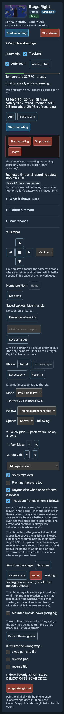

A phone on a **Hohem iSteady X3 or MT3** gimbal becomes a camera you can point from the dashboard. The camera app talks
to the gimbal over Bluetooth, so nothing else is needed: no extra box or cable, and no Hohem app running.

* **Aim it.** Hold an arrow on the camera's card and it turns, at the speed chosen; let go and it eases to a stop. If
  the page closes or the network drops, it stops by itself within half a second.
* **Let it follow.** Choose **Follow → the most prominent face** and the phone finds faces in its own picture and keeps
  that face a little above the middle, turning the gimbal calmly, at a **Calm, Normal or Quick** pace, or quicker wide and calmer zoomed in. Someone who turns
  away or walks too far for their face to be found is still followed **by their body**, and someone who walks out of the
  side of the shot is followed on round that way to meet them coming back in; lose them altogether and it **searches**,
  zooming out and swinging wider each way until it finds them again. Zoomed in, the top of the head keeps its room. Touch an arrow and you have it
  for three seconds; then following carries on.
  Following, it zooms to keep them about waist up, in as they walk away and out as they come nearer, and it turns
  faster when they are close or walking towards it.
* **Follow a performer** (Plus AI): choose a named, consenting performer, and the manager recognises them in that
  camera's picture about once a second and points the phone at them, so the director's zoom on that camera follows
  them too.
* **Solos and guests** (Plus AI): give a gimbal camera a **follow plan**: its performers in order, with **solos taking
  over** (the sound hears a guitar solo and the gimbal turns to the guitarist, even one this camera doesn't usually
  follow), optionally **prominent players** too, and **anyone** when none of them is in view, so a guest who walks on
  from the other side of the stage is followed. It holds each choice a few seconds so it doesn't flit, and says why it is
  on whom it is.
* **The zoom follows the plan**: the director's zoom on that camera frames whom the plan is on, the soloist or a guest,
  not just a listed performer.
* **Home position**: **Set home** where it points now, at the zoom it has, and **Home** turns it back there and zooms it as it was. After the phone restarts, aim
  it at home and Set home again, and every saved target lines up again, or press **Find home**: it matches what the
  camera sees now against the room it saw as its home was set, and finds home and every target by itself.
* **Checked by what it sees**: after Home or a saved target, the camera's picture is matched against the room it saw
  when that spot was saved, and a degree or two of drift is turned off before it goes on air.
* **Saved targets**: aim it at the pot and **Save as target**; "show the pot" turns and zooms it there, "back to me" puts
  it back as it was. **Go** and **Back** on the card too.

  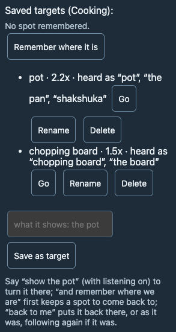
* **Tracking and zoom off, live**: switch the automatic tracking or the automatic zoom off for one camera from its card,
  or for every camera from the Show page, Operate or Stage Shots. The gimbal stops where it points, the zoom in OBS holds where it is (or as you frame it by hand), **Whole picture** undoes a zoom gone wrong,
  and switched on again each takes up from there. Or say "stop tracking" and "tracking on".
* **If it loses them**, the director takes that camera off air before the audience sees an empty shot (the programme
  runs a few seconds behind): to the best other camera when the AI rates one, otherwise to the stage shot, and it
  doesn't cut back until the gimbal is following again.
* **Aimed from the stage** (Plus AI): with the cameras on the room map, and the gimbal aimed at centre stage and **Set**
  once, the manager uses the wide shot to turn a gimbal that has lost someone back towards where they are, and one
  given a performer towards them before the director needs it. The phone's own following takes over once they are in
  its shot.
* **An MT3's own AI tracker** is shown on the card when it is tracking, and the arrows warn that they would fight it.
* **Hung upside down** from a bar or truss: one tick turns both arrows round, and **Turn picture 180°** (for any phone
  mounted upside down) turns the picture itself.
* **Portrait or landscape, from the dashboard** (an X3): one button rolls the phone to portrait or to either
  landscape, and the camera turns its picture to match (a running camera is stopped for a few seconds and started
  again). It stays that way while the camera is aimed or follows someone. **Recentre**, the gimbal's **mode** (pan and
  tilt follow, pan follow, all locked, POV) and its **battery** are on the card too.
* **Pairing from the dashboard.** A phone looks for a gimbal or cooler when asked; one can be moved from one camera to
  another, and all coolers re-paired at once, each to the phone it is clamped to.

**Steer it with an Xbox controller.** The **Operate** page shows the cameras you choose live, with no look-ahead, for
the administrator or an operator, at the PC or from a tablet on the camera Wi-Fi (an Xbox controller paired to a tablet
has been tested). The right stick aims the gimbal, the triggers zoom, **A** puts that camera on air,
**View** goes back to the stage shot and **Y** to the previous shot, a right-stick press sends the gimbal home; the
bumpers change camera, and several controllers can drive several cameras at once. Each tile arms, streams and records
its camera (for operators too) and shows its temperature, and the bar's **Arm all cameras** and **Start all camera streams**
get every camera ready at once, asking first with the list. Every camera in use is there, gimbal
or not, each with the same *What it shows* as its card, to change mid-show. Each tile says which lens is making the
picture (main, telephoto or ultrawide) and the zoom, and its live picture can run at 24 frames a second. Each tile has the same Follow
control and follow plan as the camera's card, and Home and Set home: Home stops following while it turns, and a
camera that was following picks it up again once it is home.
**Positions are set up here too:** under each gimbal camera's picture, aim and zoom it and press **Save as…**; **Go**
checks one, **Update to here** fixes it, and Remote's keys and voice calls use the same positions. Hold the
controller's **Menu** and press A, B, X or Y to go to positions 1 to 4. A **setup tech** can open this page to line the
shots up from a phone on stage before the show, with nothing that cuts, arms, streams or records.
No controller? On-screen arrows and zoom buttons do the same, and **Aim** and **Zoom** sliders set how quick they are.
All the live pictures come over one connection, so the page keeps up on a tablet, at `https://operate.mcvsaid.local`
on the camera network.

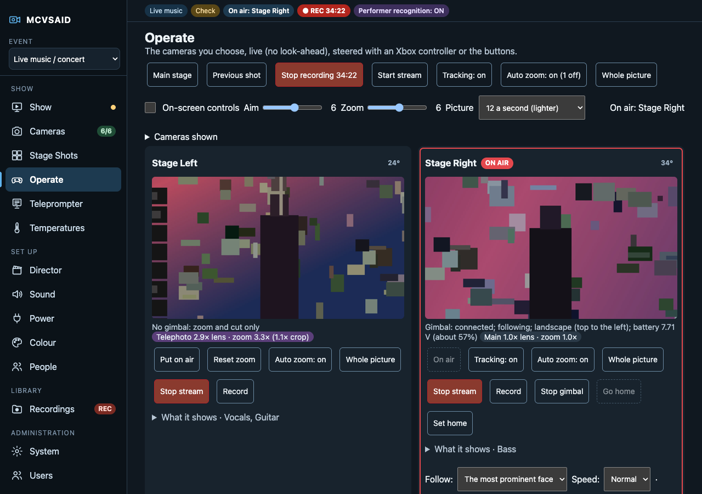

The commands were worked out from Hohem's own app, so a firmware update could change them. (In the demonstration,
Stage Right is on a gimbal; its pictures are drawn, so nothing moves.)

<br clear="right">

## Phone coolers (experimental)

Heat is what limits a phone camera: a phone streaming 4K for a whole show can run warm enough that recording its own
copy at the same time is not safe, and the app stops recording at 47 °C to protect the phone and the file. A
**clip-on thermoelectric cooler** removes most of that heat.

**What we measured** (one evening each, so treat them as early results):

| | Without a cooler | With a Black Shark MagCooler 5 Pro |
| --- | --- | --- |
| Galaxy S23, 4K at 25 Mb/s | streaming only: 43–44 °C within the hour | **streaming and recording together for 2¼ hours: 22–25 °C** |
| Galaxy S20 FE, 4K at 25 Mb/s | streaming only: up to 50 °C | streaming, and briefly recording too: 5–15 °C |

So with a cooler, **recording on the phone while it streams becomes practical**, for a full-quality copy of every
camera even when the network or the production computer has a bad moment.

**Recommendations**

* **Smart fan mode** (the default here): the cooler follows the phone's temperature. Use more only if a phone still
  warms up.
* **Watch for condensation.** These coolers can chill a phone below the room's temperature (the S20 FE read 5 °C), and
  water can then form on it, inside it or on the lens, in a humid room especially. Keep it in Smart, and let a cold
  phone warm up before taking the cooler off.
* **Power the cooler from its own USB charger**, not from a PoE-to-USB-C adapter on the camera network's switch: one
  such adapter took a whole camera network down in testing.
* **Its auto shutdown is kept off** by the camera app: when its timer runs out the cooler turns itself off and cannot
  be woken over Bluetooth until its button is pressed, so the phone switches it off and checks every half minute that
  it stays off.
* **Test on your own phones** for the full length of a show, recording and streaming, before relying on it.

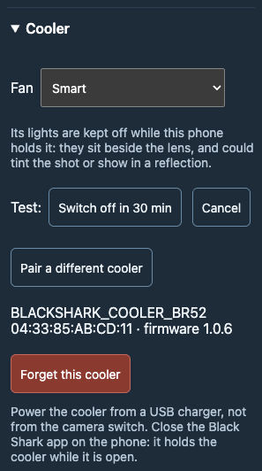

**Managed from the dashboard (experimental, in development).** The camera app finds the cooler clamped to its phone
and controls it over Bluetooth: the fan mode chosen on the phone's card, **its lights kept off** so they never show in
a shot or a reflection, and the cooler's temperature and fan speed shown beside the phone's own, with the Temperatures
page listing each cooler and the readiness check warning if one goes missing. It speaks the cooler's own Bluetooth
commands, which were worked out from Black Shark's app rather than published by Black Shark, so a firmware update could
change them; only the MagCooler 5 Pro has been tried. Close Black Shark's app while the camera app is in charge: only
one of them can hold the cooler at a time.

**Chargers on smart plugs.** The USB charger hubs for coolers and gimbals can sit on TP-Link Tapo smart plugs, switched on
and off from the dashboard's Power page, which also shows whether each is on and whether it answers, and which gimbals and
coolers each one charges: which camera each is on now, and a gimbal's battery. Switching one off says what stops charging,
and warns when a cooler on it is keeping an armed phone cool. The manager reaches the plug directly on
your network rather than through TP-Link's cloud, though the plug must first be added in the Tapo app and wants that account's login,
which stays on your computer. Only the buttons switch it: nothing turns it off by itself in the middle of a show.

**The Mac stays awake through the show.** An unattended laptop running the show won't doze off mid-performance: while OBS
records or streams, or a camera does, the manager keeps the Mac awake with macOS's own caffeinate, and for a while after,
between sets. Add the times of your shows to its schedule, weekly or on a date, or keep it awake for the next few hours while
setting up. It warns when the Mac is on battery or its lid could close, which no program can stop.

<br clear="right">

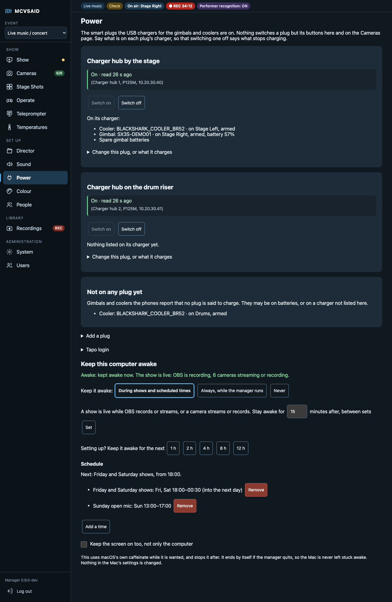

## System and locations

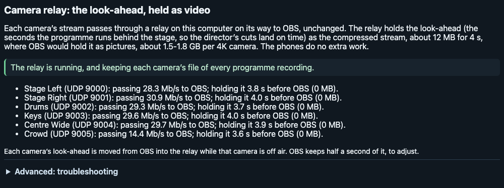

System › This computer shows the camera relay at work, the AI assistance level and how OBS decodes each camera; System ›
Updates has the manager's updates and the phones' camera app together. The relay can be switched off there, under *Advanced: troubleshooting*; without the SRT library it falls back
by itself to cameras streaming straight to OBS, and says why.

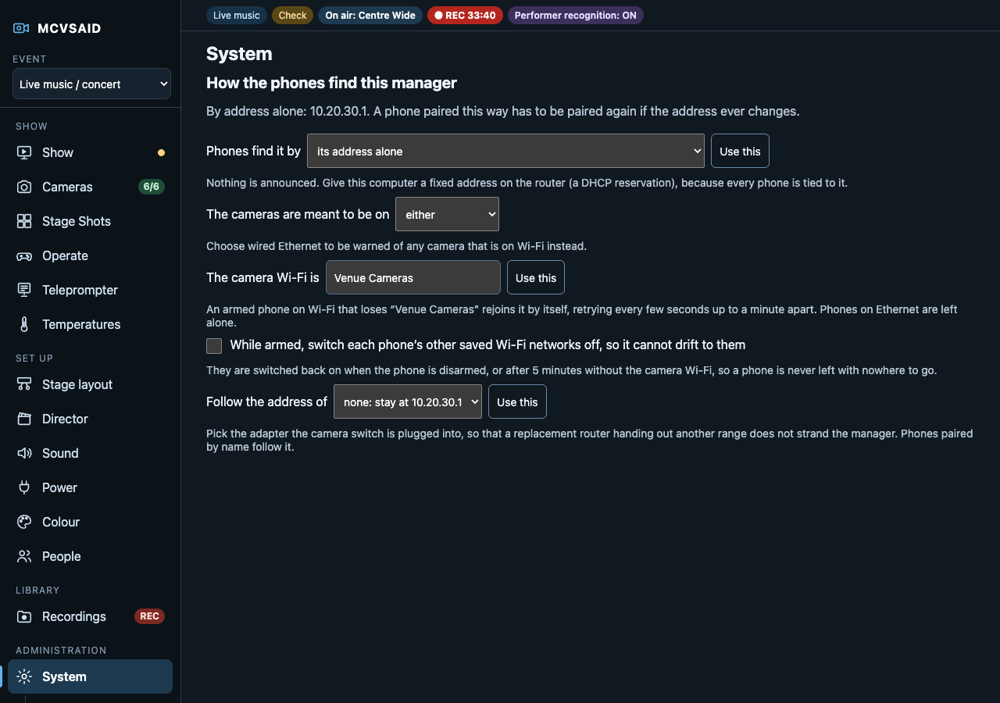

How the phones find the manager (by its address, or a name announced on the network), the camera Wi-Fi they rejoin,
named **users**, each logging in as themselves as an administrator, an operator (who can run a show from a tablet on the
camera network, with fewer powers than an administrator) or Stage Shots on a phone, everyone logged in,
and updates of the manager itself from the dashboard.

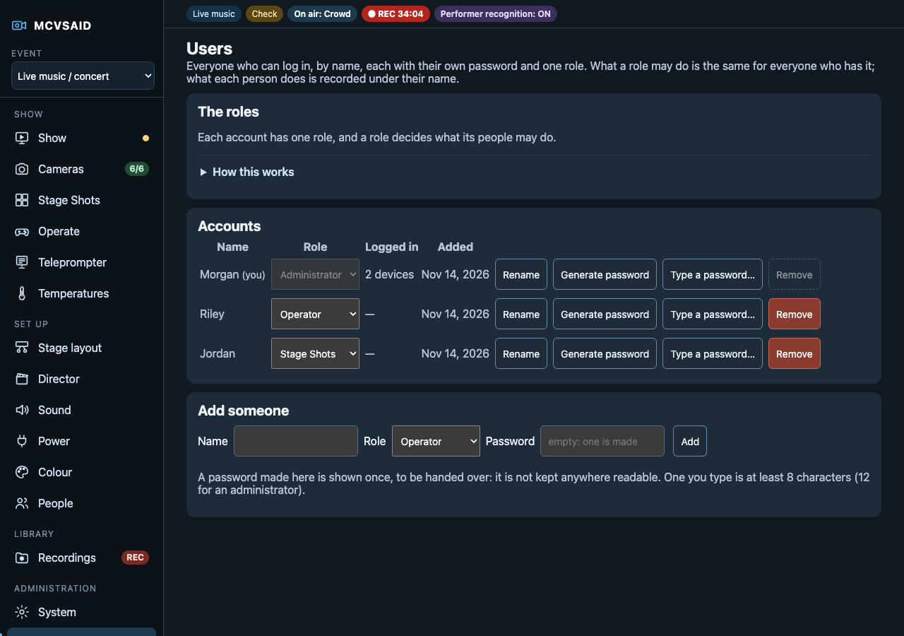

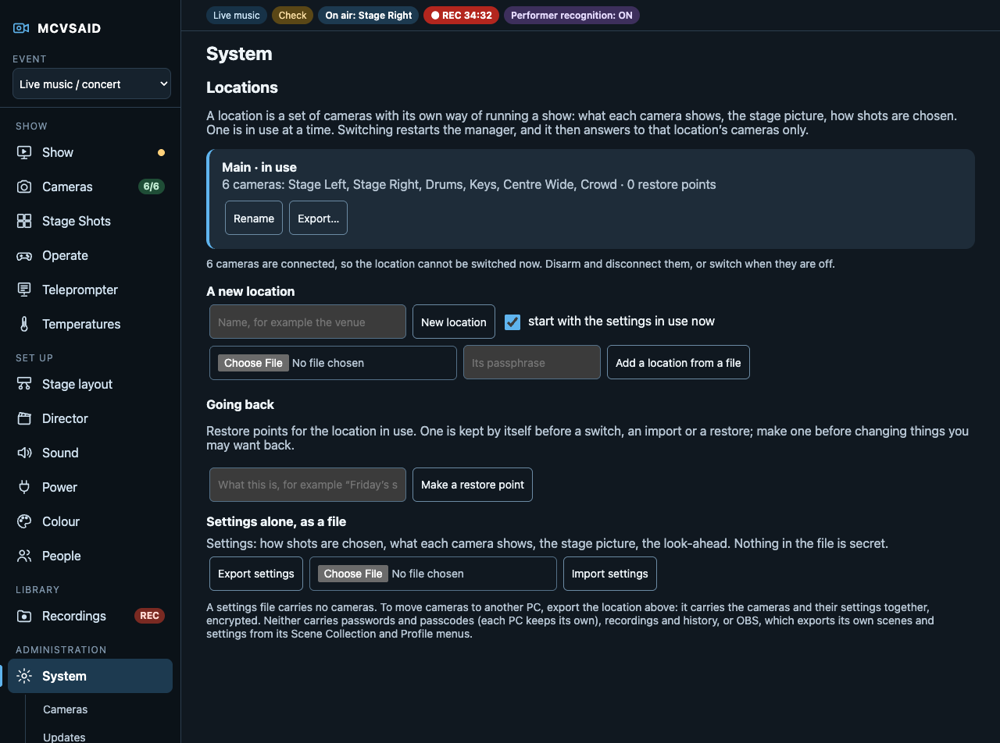

A **location** is a set of cameras with its own way of running a show. One computer can move between venues, with
restore points to go back to an earlier set-up, and a whole location can be exported (encrypted) to set up another
computer. A camera a location does not always use can be set **Set aside**, so it never holds up the readiness
check or appears in the show, a camera can be **renamed** at any time (its OBS source and scenes take the new name
too, without a cut), and one can be **removed** for good, its pairing revoked.

## Teleprompter: the script on a tablet, lit as it is said

Write a script on the **Teleprompter** page, a heading for each section, and open it on a tablet beside the camera at
`https://teleprompter.mcvsaid.local` with its PIN (nothing else of the manager opens with it). The words are large, the
one being said is lit as it is said, karaoke style, and the script keeps it at the reading line. It listens with the
speech recognition already on the production computer, so no words leave the building or are kept.

* **Made for the event.** In Cooking the recipe is a script of its own, a section for each step with its concise
  wording first, and it moves with the recipe (and the recipe with it). At a concert a section is lyrics, lit a line at
  a time and moved on by hand; worship has readings followed by voice and sermon points as notes; podcasts and panels
  an opening, ad reads and questions; theatre the MC's links.
* **By hand too.** Section and line buttons, **Play** at a speed you set, a page-turner pedal (it sends Page Down), or
  an Xbox controller. **Mirror** for teleprompter glass, and the words as large as you like.
* **On air at a glance.** The top of the tablet shows REC and the camera on air.

## Karaoke night: sign up from a phone, sing to the screen

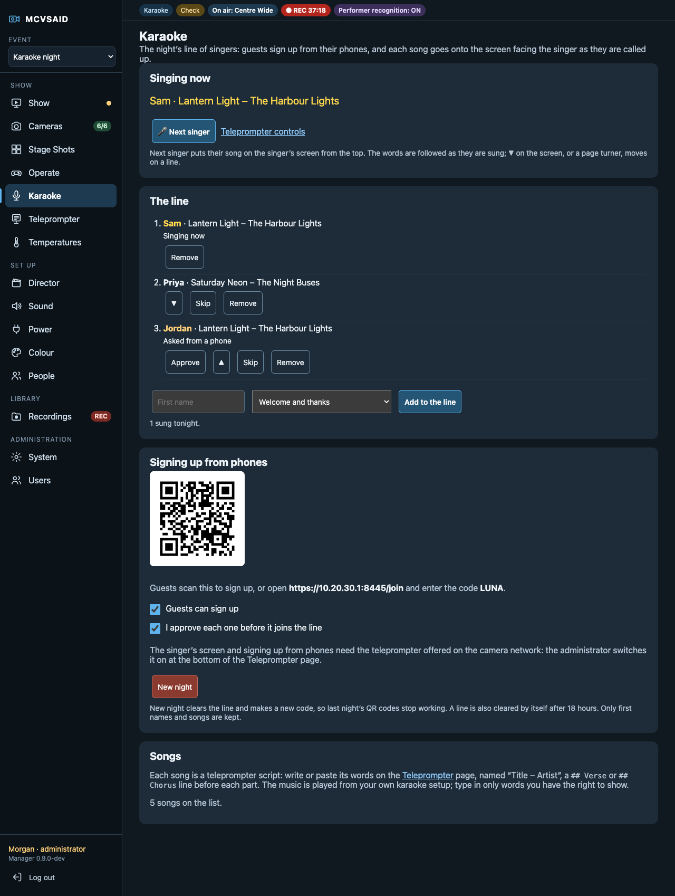

Choose **Karaoke night** as the kind of event and the cameras become the singer, a duet partner, the host, the stage and
the crowd: the director stays on the singer, goes to the crowd as it sings along, and to the stage between singers.

* **Sign up from a phone.** Guests scan the QR code (on the Karaoke page, and on the singer's screen between songs),
  give a first name and pick a song. No app, no account. The host approves each one, reorders the line and calls up
  the next singer.
* **The words on a screen facing the singer**, at `https://karaoke.mcvsaid.local` with the teleprompter's PIN: who is
  singing and who is next, each line lit as it is sung.
* **Your music, your words.** The track plays from your own karaoke setup. Songs are written or pasted in by you, so
  show only words you have the right to show.
* **Only what the night needs.** A first name and the song, cleared at *New night* or after 18 hours; nothing sung is
  kept.

## On a phone or tablet

<p>
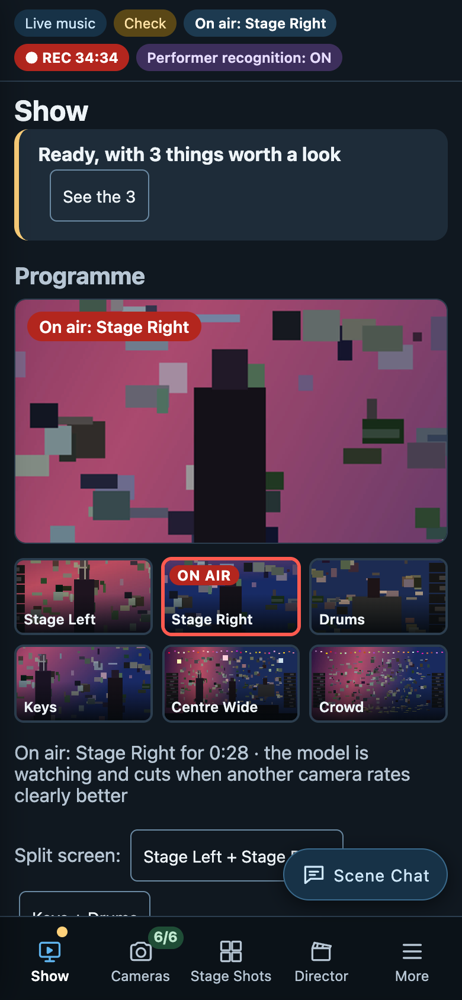
&nbsp;
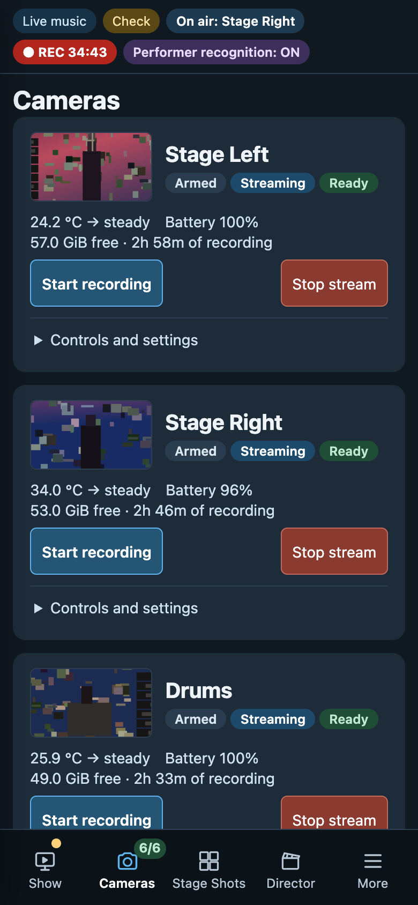
</p>

On a phone the main pages sit along the bottom, with More for the rest; a tablet gets an icon strip that opens out.

---

## The production computer

Everything but the cameras runs on one computer: OBS, the manager, the camera relay and, if used, the shot-choosing
model. It runs on **Linux or macOS**. These figures come from the two computers it has run on; check them on the one
that will run your show, with every camera streaming at its intended size for the length of a show.

| | Mac (runs it live) | Linux workstation (built on) |
| --- | --- | --- |
| **Computer** | MacBook Pro, M5 Pro (18 cores), 48 GB unified memory, macOS 26.6 | Intel i9-14900HX, 32 GB, NVIDIA RTX 4090 Laptop GPU, Linux Mint |
| **Decoding the cameras** | in hardware (VideoToolbox): six 4K cameras for 27% of one processor core | on the processor: six 4K cameras for about 16% of it (the graphics card's decoder filled up at three 4K and three 1440p) |
| **AI** | Standard (the Plus detector measured there too) | Standard |
| **Shot-choosing model** | llama.cpp natively on the Mac's graphics (Metal), Qwen3-VL 8B: about 0.6 s an answer idle, about 2.2 s to rate six cameras during a show | llama.cpp in Docker on the graphics card: about 1 s an answer |
| **Software** | OBS for macOS, Homebrew (Python 3.13, ffmpeg, SRT), launchd services | OBS (Flatpak), Python 3.12+, systemd user services |

**Memory on the Mac.** Measured with six cameras at 4K (25 Mb/s each), a 1080p programme and a 5.5 s look-ahead:

| | Camera relay off | Camera relay on |
| --- | --- | --- |
| OBS (the look-ahead held as pictures, or compressed in the relay) | 11.0 GB | 2.6 GB |
| Shot-choosing model | about 8 GB (2.4 GB of its own and 5.7 GB of weights on the graphics) | the same |
| **The whole Mac in use**, other apps included | **38.8 GB** | **30.7 GB** |

The processor was 42% busy and the graphics 65%. In use, with five cameras at 4K, the Mac's memory in use has been seen
to approach 40 GB (that reading includes OBS's canvas and recording and whatever else is open). So:

* **48 GB is recommended for five or six cameras at 4K with the shot-choosing model**, with the camera relay on (the
  default), which saved about 1.4 GB of memory per 4K camera.
* **32 GB** is enough for fewer or smaller cameras, or at No AI. The person detector for Plus adds little: about 11 ms
  a picture on the M5 Pro.
* On a Mac the video decoder's load cannot be read, soundcheck by sound needs Linux (PipeWire), and listening for
  instruments needs a loopback sound device such as BlackHole.

**Everything else**

* **Disk** for the programme (about 6 GB an hour) and, if the computer keeps each camera's stream, about 13 GB
  an hour per 4K camera (25 Mb/s), twice that until a recording's files are made. The readiness check works this out
  from the cameras' real rates.
* **A wired gigabit network adapter** on the cameras' own network: six 4K cameras are about 150 Mb/s. Phones on USB-C
  Ethernet adapters (with PoE, one cable for data and power) are steadier than on Wi-Fi at that rate. A separate
  connection is needed for streaming out.

## The camera app

* Android 8 or later; tested on Pixel 3, 4a and 8, and Galaxy S20 FE, S23 and S23+. The latest version is under
  [Releases](../../releases).
* 1080p, 1440p or 4K at 30 fps, H.264 with AAC sound, over SRT; recording on the phone alongside, where the phone stays
  cool enough.
* Runs as the phone's device manager, so it can be armed, restarted, updated and have its clock set remotely, with the
  screen lock left on.
* White balance and exposure set from the manager; a frozen picture revived by itself; the camera Wi-Fi rejoined by
  itself; its battery held short of full while charging; silent while armed; a clamped-on cooler controlled over
  Bluetooth.
* A Hohem iSteady X3 or MT3 gimbal aimed over Bluetooth, and steered by the phone itself to follow a face or a person.
* Face blur on the phone (experimental): every face found (YuNet) and blurred before anything is recorded or sent, and
  where it blurred each frame reported to the computer, which backs it up.
* Each release here is signed with the installation's release key, and the checksum of each file is published beside
  it. New versions are built, signed and published here automatically.

## Security, briefly

* Phones and manager authenticate each other: a per-camera credential (kept on the computer only as a hash) and a
  pinned certificate.
* The dashboard is reachable from the computer itself; from the camera network over HTTPS, with an operator login, or
  an administrator's password and a code from an authenticator app (a device can be trusted for 30 days) once that is
  switched on at the computer. One login (and one trusted device) serves every easy address of the dashboard
  (`operate.`, `remote.`, `calibrate.`), never Stage Shots or the teleprompter, which keep their own. What an
  administrator at the computer keeps there stays out of reach of the network.
* Set-up codes and USB set-up hand each phone its own pairing; passwords typed for a code are not stored.
* Nothing is sent from an installation to the project: no usage reporting, crash reporting or footage.

Found a security problem? Please report it privately to **security@mcvsaid.com**, never in a public issue.
