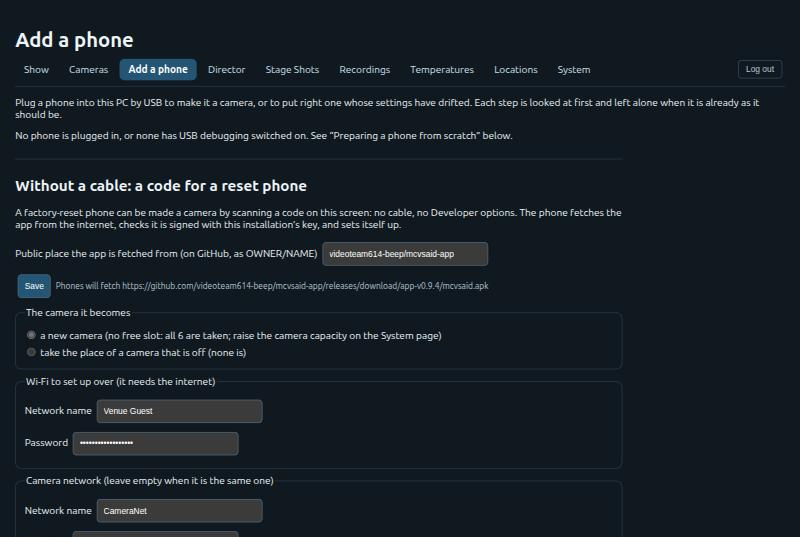
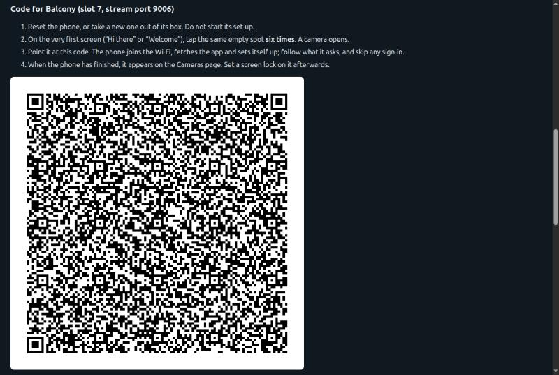
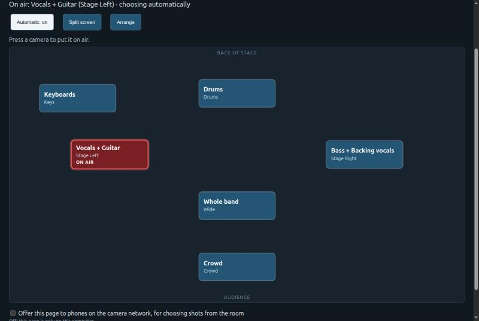
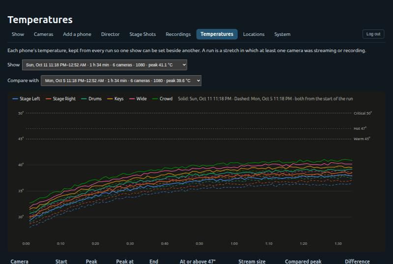
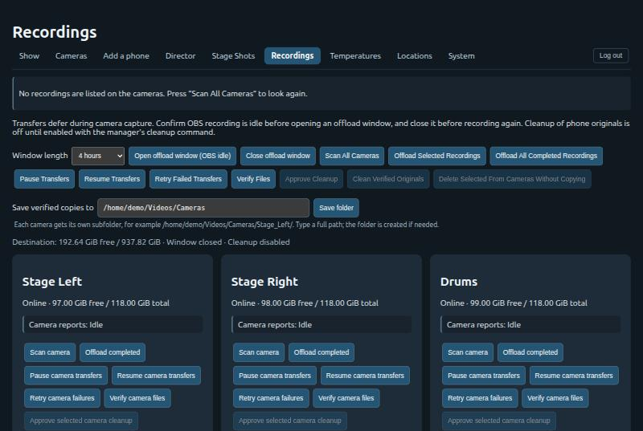
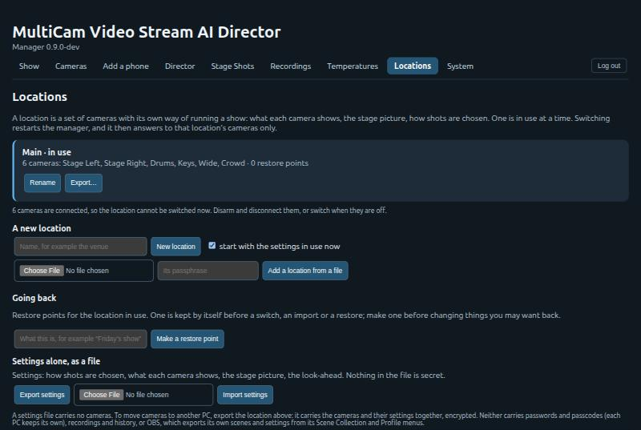
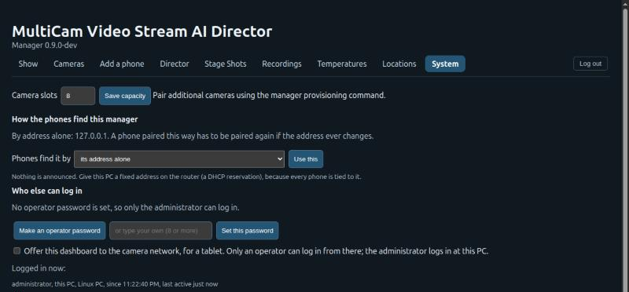

# MCVSAID — MultiCam Video Stream AI Director

**Turn a handful of Android phones into a multi-camera live production, directed automatically.**

MCVSAID makes ordinary Android phones into remotely managed cameras for live music and events. Each phone streams
its picture to [OBS](https://obsproject.com/) on a production PC. A manager on that PC keeps every feed in step,
watches the health of every phone, and can choose the shots itself with a vision model running on the PC's own
graphics card. Cameras can be mounted out of reach: everything is done from a browser.

This repository holds the **signed builds of the camera app**, under [Releases](../../releases). A phone being set up
fetches the app from here; the app does nothing by itself until it is paired with an MCVSAID manager.

> The screenshots below are from a demonstration manager with six made-up cameras, not a real show.

---

## How it fits together

```
 Android phones (camera app)                    Production PC
 ┌──────────────┐  picture + sound (SRT)   ┌──────────────────────────────┐
 │ Stage Left   │ ───────────────────────▶ │ OBS: one source per camera,  │──▶ recording,
 │ Stage Right  │                          │ full-screen and split scenes │    live stream
 │ Drums  …     │  control (TLS, pinned)   ├──────────────────────────────┤
 │              │ ◀──────────────────────▶ │ MCVSAID manager              │
 └──────────────┘                          │  · readiness and health      │◀── browser on the PC,
                                           │  · feed alignment            │    a tablet, or a phone
                                           │  · AI shot choosing          │    in the crowd
                                           │  · offload of recordings     │
                                           └──────────────────────────────┘
```

* Each phone streams over **SRT** and can record its own full-quality copy at the same time.
* Every picture carries a small **timing strip**, which the manager reads to line all the feeds up to the
  millisecond; OBS never shows it.
* The control connection is **encrypted and pinned** to the manager's certificate. Phones find the manager by a
  name on the local network, so its address can change.

---

## The show at a glance


One line answers the only question that matters before doors open: **is everything ready?** It is worked out
continuously from the PC (OBS, memory, recording space, the camera network) and from every camera (connection,
clock, power, temperature, Wi-Fi, stream target), and names exactly what needs attention. Below it: start and stop
every camera at once, a heat forecast for the length of the show, and the programme itself — what is on air, and
any camera or split screen one press away.

## Every camera, in detail


Each camera has its own card: which performers or instruments it shows (up to eight, or the whole band), where to
zoom during a solo, and a readiness summary. **Band profiles** save who stands where, so the same band on the same
stage is set up in one step.


Temperature with its trend and a time-to-limit estimate, battery and Wi-Fi signal, free space and how long local
recording can run, picture size, **lens choice and sensor zoom**, all changed from the PC while the phone stays on
its mount. Clocks are set automatically, and app updates roll out one unarmed camera at a time.

## Adding a phone



Plug a phone in by USB and the page installs the app, grants its permissions, makes it the phone's manager (so it
can be armed, restarted and updated remotely), exempts it from battery saving and pairs it — each step checked first
and skipped when already done, so the same page repairs a phone whose settings have drifted.



**No cable at all:** a factory-reset phone taps its welcome screen six times and scans this code. It joins the Wi-Fi,
downloads the app from this repository, checks it is signed with the installation's key, sets itself up, moves to the
camera network and connects. The code carries everything the phone needs; the manager keeps none of its secrets.

## The director


Shots can be chosen by a **vision model** running locally (any OpenAI-compatible server, such as llama.cpp), guided
by plain-language wishes ("stay on whoever is singing; a wide shot between songs"). It can **zoom in on a
performer** — face, hands, the whole person — without going below a real 720p, and **listen** to the programme sound
to favour the camera on the instrument that is to the fore, including solos. A **look-ahead** holds the programme a
few seconds behind real life so every cut lands cleanly. Without a model, it can rotate through the cameras on a
timer, or leave the choice to a person.

## Stage Shots



The cameras laid out as they stand on the stage, by what they show. Press one to put it on air, or pick two for a
split screen. The page can be offered to phones on the camera network, behind its own passcode, so someone in the
crowd can call the shots by hand.

## Temperatures, run by run



Every phone's temperature is kept from every run, so one show can be set beside another: which camera ran hottest,
how long it took to settle, and whether a change of mount or picture size helped.

## Recordings



Each phone's own full-quality recording is copied to the PC over the network after the show, verified, and filed by
camera. Phones' copies are only ever cleared when that is explicitly switched on.

## Locations



A **location** is a set of cameras with its own way of running a show. One PC can move between venues, with restore
points to go back to an earlier set-up, and a whole location can be exported (encrypted) to set up another PC.

## System



How the phones find the manager (by its address, or a name announced on the network), an **operator** login for a
tablet on the camera network with fewer powers than the administrator, every session that is logged in, and updates
of the manager itself from the dashboard.

---

## The camera app

* Android 8 or later; tested on Pixel 3, 4a and 8, and Galaxy S20 FE.
* 1080p, 1440p or 4K at 30 fps, H.264 with AAC sound, over SRT; local MP4 recording alongside.
* Runs as the phone's device manager so it can be armed, restarted, updated and have its clock set remotely, with
  the screen lock left on.
* Each release here is signed with the installation's release key. The checksum of each file is published beside it.

## Security, briefly

* Phones and manager authenticate each other: a per-camera credential (kept on the PC only as a hash) and a pinned
  certificate.
* The dashboard is reachable from the PC itself; from the camera network only with an operator login, over HTTPS.
* Set-up codes and USB set-up hand each phone its own pairing; passwords typed for a code are not stored.
