# Why MCVSAID

**Set up as many dedicated phones as you need. Press one button. Every camera starts recording, streaming, or both.**

MCVSAID, the MultiCam Video Stream AI Director, turns Android camera phones into a managed, self-healing multi-camera
rig. A flagship phone from the last few years has a large sensor, sharp 4K and its own zoom lenses, for a few hundred
dollars used: more camera for the money than a dedicated camera at the same price. One local computer runs MCVSAID,
and an optional AI director can choose the shots by watching each moment before it airs. There is no cloud and no
subscription: the cameras, the director and the recordings stay on your own computer, and your footage goes only where
you stream it.

Most phone multicam tools stop once the feeds reach a switcher. Most auto-directors either choose shots from audio
levels alone or work only with their own cameras. MCVSAID covers the whole chain: setup, health, sync, colour, shot
choice and edit-ready recordings. You can steer it at any step in plain language, or out loud. Put a phone on a
low-cost gimbal and it becomes a camera you can aim from the dashboard, or one that follows a face by itself. Faces can
be blurred on the phone itself, before any picture leaves it.

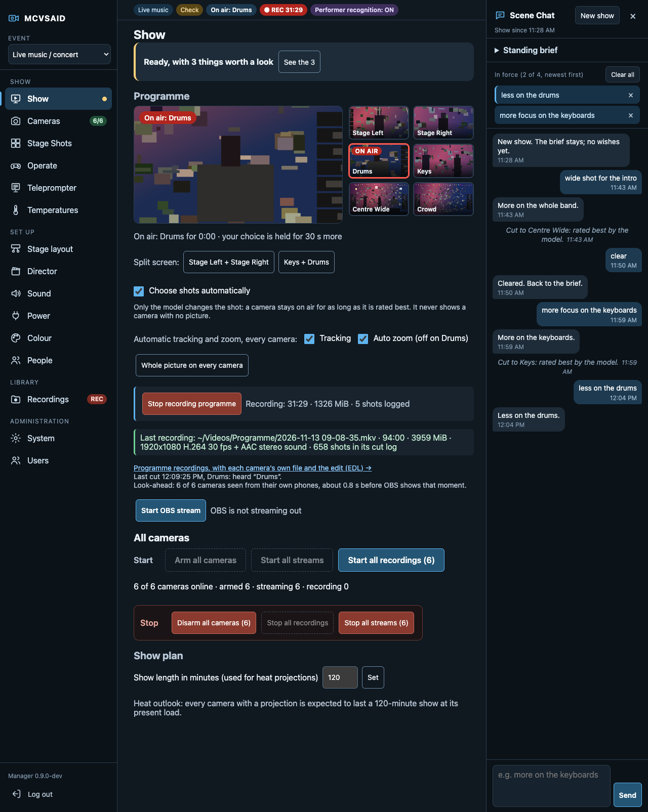

## At a glance

- **Multiple dedicated phones, one button:** every camera recording or streaming at once.
- **No camera operators needed:** a handful of camera phones and one computer make a directed multicam show.
- **Flagship cameras at used prices:** a Galaxy S23 with a 3x zoom lens costs about $280 used, and about $400 on a
  gimbal: a fraction of a 4K PTZ camera. See [Camera hardware](#camera-hardware-more-camera-for-the-money).
- **Phones on gimbals become robotic cameras:** aimed from the dashboard, following a face or a named performer by
  themselves, or sent to a saved spot when the host says "show the pot".
- **Automation you can switch off mid-show:** tracking and the automatic zoom, for one camera or every camera at once.
- **A map of any set:** a concert stage, a kitchen or a podcast table, made from a few photos, a floor plan or a
  template, with the cameras placed against it.
- **Faces blurred on the camera itself**, with the computer as a backup that catches the faces a phone misses.
- **Voices that line up with mouths:** each camera's sound is measured against its picture and set to match.
- **A teleprompter that listens:** the script on a tablet, the word being said lit as it is said.
- **Karaoke night, run from the dashboard:** guests sign up from their phones, and the words go on a screen facing
  the singer, lit as they are sung.
- **An AI director that watches every camera before the audience does**, and takes notes in plain English.
- **Mount the phones once.** Set them up, match their colour, update and fix them from a browser.
- **Everyone logs in as themselves:** each person has a role, and an administrator can raise, lower or change it.
- **Your show, your computer:** no cloud, no subscription, and your footage goes only where you stream it. MCVSAID
  goes online by itself only to check for updates, from GitHub; otherwise only to fetch what you ask for, such as an
  AI model or a recipe page.
- **The AI's cut is a starting point.** Keep each camera's own file and the edit, and re-cut the show yourself.

## What MCVSAID does that others don't

### 1. Dedicated phones, one button: every camera recording or streaming at once

If all you want is several dedicated phones that start recording, streaming, or both at a single button press, MCVSAID is
built for you. The Show page arms, starts and stops every camera together, and one readiness line tells you when all of
them are good to go.

Getting there is just as simple. A factory-reset phone taps its welcome screen six times, scans a code, installs the
signed app and joins the camera network, with no cable needed. From then on it is managed remotely: arm it, restart
it, update it one camera at a time, and correct its clock. Each phone revives a frozen picture on its own, rejoins
Wi-Fi, holds its battery short of full, and goes silent while armed. Other phone apps assume someone is holding the
phone. With MCVSAID you mount the phones once and never touch them again.

### 2. A director that sees the shot before the audience does

A look-ahead holds the programme a few seconds behind real life. A vision model running on your own computer rates
every camera from the phones' own pictures, so each cut lands cleanly on air. In the demo, the model rated six cameras
in about half a second, and every cut was seen 0.7 to 5 seconds before OBS showed it. Audio-only switchers react after
the fact, and they can't tell an empty or blurry shot from a good one.

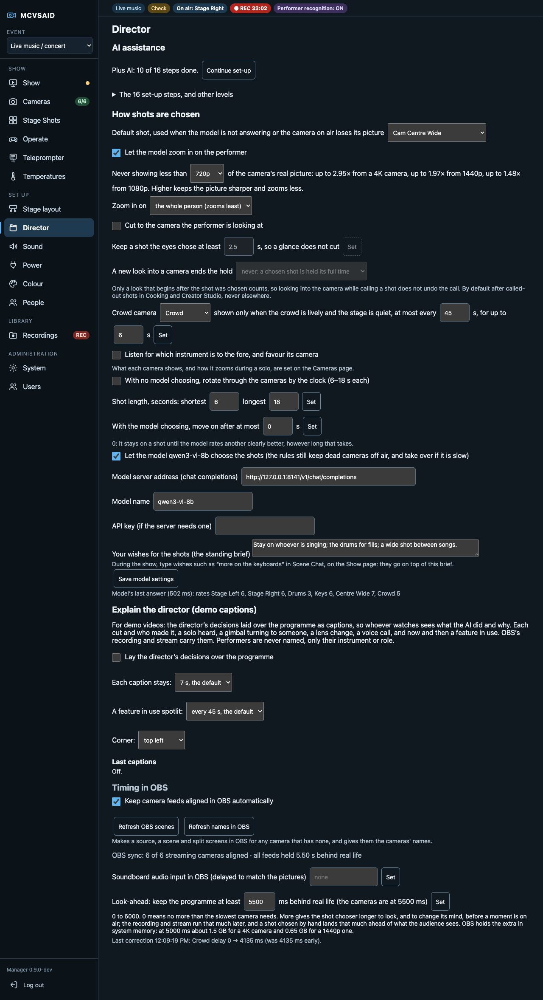

### 3. Directing in plain language, or out loud, mid-show

A standing brief sets the intent, for example "stay on whoever is singing; the drums for fills". During the show,
Scene Chat takes wishes such as "less on the drums". Up to four wishes are active at once, each lasts 15 minutes, and
the log explains every cut. A host can also **call shots aloud**: say "cut to the overhead" or "show the stove" and
the director cuts to that camera and holds it. That's on by default in Cooking and Creator Studio, where one person
talks to their own cameras, and off where music or a congregation could set it off by mistake. Speech is recognised on
the computer, and nothing heard is sent anywhere or kept. A call only a phone heard waits for the computer to hear it
too, and two cameras called in one breath cut to neither, so a misheard word doesn't cut the show. A host can also
send a gimbal camera to a spot saved for it: "let's look at the pot now" turns and zooms it there, and "back to me"
puts it back on the host as it was. We haven't found another auto-director that takes live direction in words.

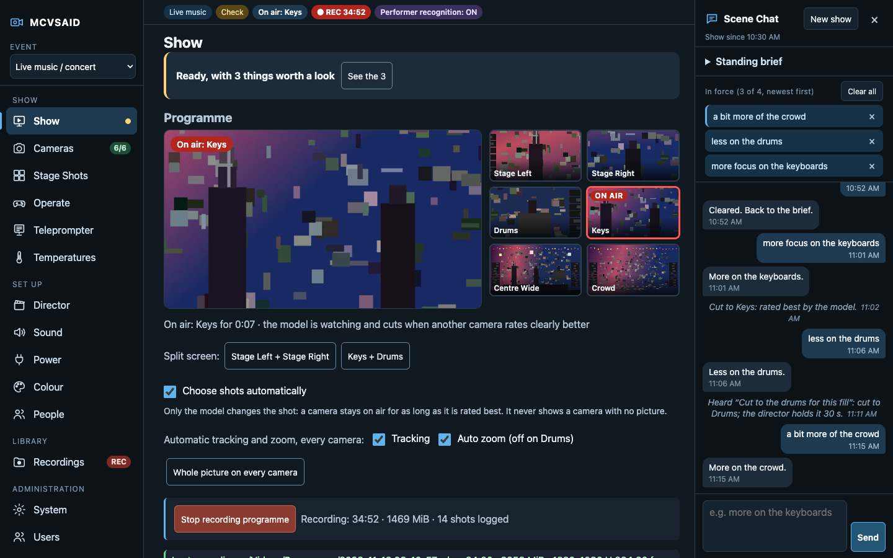

### 4. Shot logic tuned to the kind of event

Live music, worship, podcasts, panels, theatre and cooking each have their own camera roles and pacing. Talk formats
cut to whoever is speaking and allow for mic bleed, coughs and pauses. Cooking follows a loaded recipe step by step,
makes sure each step's station is seen, and can put the recipe, a QR code and captions on screen, all the time, at
key moments or only when asked. **Prep for the show** turns a long recipe into short steps the cook can call out,
checks that a camera covers each one, and lists what to say to rehearse. During the show the cook says "step two" or
a step in its own words and the recipe follows, forward or back. Press Record and it starts afresh. Creator Studio lets
you build your own framings from body regions.

A **teleprompter** on a tablet beside the camera, at `https://teleprompter.mcvsaid.local` behind its own PIN, follows the
speaker word by word, karaoke style, by listening on the computer itself. It too suits the event: the recipe's steps in
Cooking (and moving with them), lyrics a line at a time at a concert, readings and sermon points at worship, an opening,
ad reads and questions on a podcast or panel. A page-turner pedal or an Xbox controller moves it on by hand.

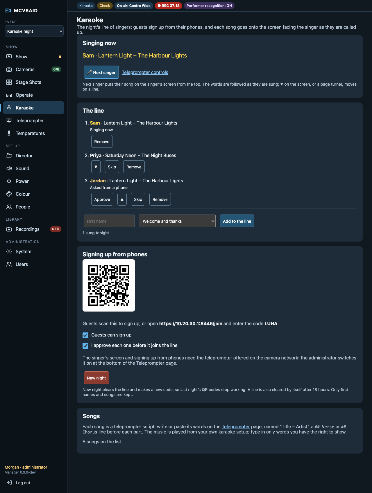

### 5. Virtual camera operators: zoom, follow, solo, gaze, crowd

The director can crop in on a performer and follow them. It won't zoom in on an empty frame, and it never drops below
a resolution you set, such as 1080p. It switches a phone to its telephoto lens only while that camera is off air. It
favours the instrument that leads the mix, cuts to whoever a performer is looking at, and shows the crowd only when
the crowd is lively and the stage is quiet. With a host it works at a host's pace: it cuts to them just before they
turn to their camera, and after a short look goes back to the shot it left. One fixed phone does the work of an operator with a zoom lens.

None of this is all or nothing. During the show an operator can switch tracking and the automatic zoom off and on, for
one camera or for every camera at once, from the camera cards, the Show page, Stage Shots or the Operate page on a
tablet, or by saying "stop tracking" or "auto zoom off". A camera switched off holds its aim and its zoom where they
are, and **Whole picture** puts back a camera's full frame at once.

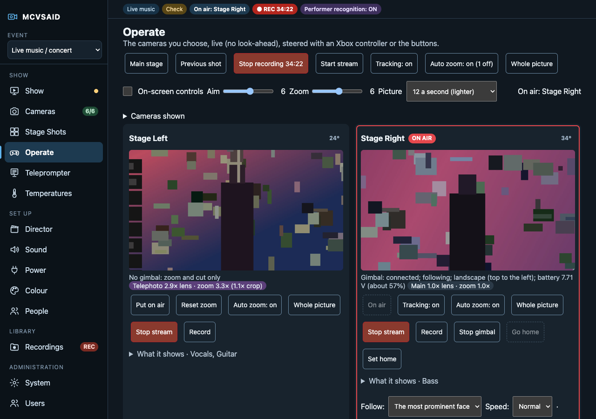

### 6. Robotic cameras for the price of a phone gimbal

Put a camera phone on a **Hohem iSteady X3 or MT3** gimbal, a consumer gimbal costing a small fraction of a PTZ
camera, and the camera app drives it over Bluetooth, with no extra box or cable. Hold an arrow on the camera's card
and it turns; let go and it eases to a stop. Press **Follow** and the phone keeps the most prominent face in frame by
itself, still following someone who turns away by their body, at a Calm, Normal or Quick pace. With performer
recognition on, it can follow a named, consenting performer instead, so the director's zoom on that camera follows
them too. Following, it zooms to keep the person about waist up as they walk nearer or further, and turns faster when
they are close. It works hung upside down, and the director keeps cutting between this camera and the rest as usual.
An X3 also turns the phone between portrait and either landscape from the camera card, recentres, changes its work
mode and reports its battery. **Saved targets** keep the aim and zoom for things on the set, such as the pot, the
chopping board or a guitar on its stand, so a camera can be sent there from the card or by voice and brought back. An
operator can take over from a tablet with an Xbox controller or on-screen buttons, with the speed set to taste.

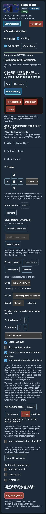

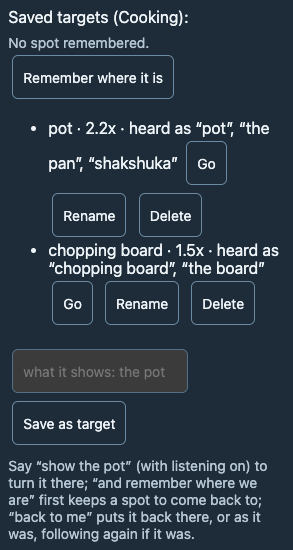

### 7. Faces blurred on the camera, before anything leaves it

For a camera that must never record or send an unblurred face, such as an audience camera, a church congregation or a
school event, the phone itself finds and blurs every face before encoding. Its stream, OBS and every recording of that
camera are blurred for good, and no unblurred copy exists anywhere. The production computer can act as a backup,
watching the same camera a few seconds ahead of the programme and covering any face the phone missed, such as someone
walking into shot. The phone reports what it blurred in each frame, so only the misses are added. On the computer
alone, faces can be blurred in OBS for every face, everyone except consenting performers, or only chosen people. It's
experimental, and we say so plainly: it can miss faces.

### 8. Heat treated as a first-class problem

MCVSAID tracks each phone's temperature, its trend and a forecast against the planned show length. You can compare
runs side by side. It also controls clip-on Black Shark coolers over Bluetooth, keeps their lights off and keeps their
own auto shutdown off, so a cooler doesn't switch itself off mid-show. Coolers are paired, moved between phones or
re-paired all at once from the dashboard, each to the phone it is clamped to. The USB hubs that charge the gimbals and
coolers can sit on Tapo smart plugs, switched from a Power page that shows what each plug charges and warns before
switching off a cooler on an armed camera. In early tests, a Galaxy S23 with a cooler stayed at 22 to 25 °C while
streaming and recording 4K for 2¼ hours. Without a cooler, it reached 43 to 44 °C streaming alone.

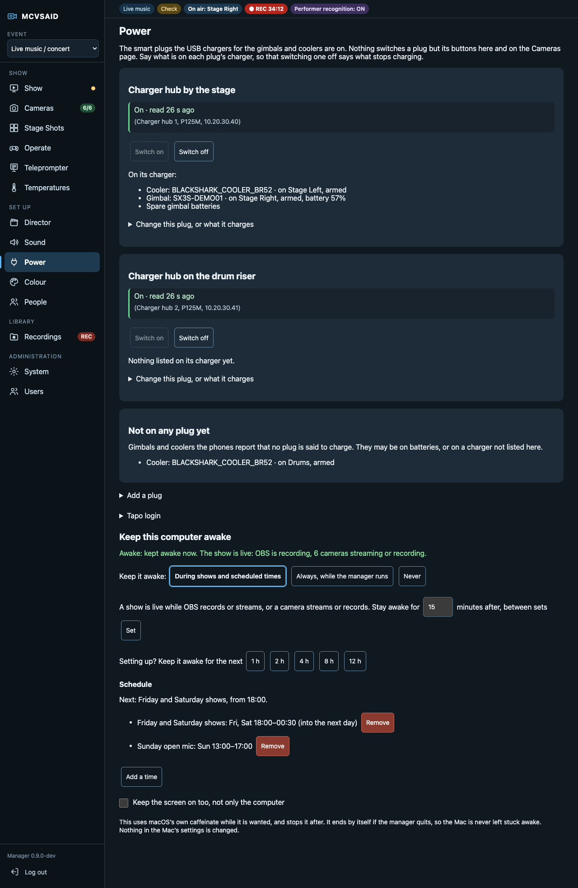

### 9. One answer to "are we ready?"

A single readiness line checks the computer, OBS, the network, the camera relay, the model and every camera, then says
what needs attention and how to fix it. Stage Shots lays the cameras out as they stand on stage, and a room map shows
what each lens sees. Each kind of event can have a set of its own: take a few photos of the set with any phone, mark
four floor points round something of known size, and the photos are straightened into a top-down map to scale, in the
browser, without the photos ever being uploaded. A floor plan (a picture or a PDF page) or a template for each kind of
event works too, from a concert stage with a drum riser to a kitchen counter, stove and prep table. You can share the
page with a phone in the crowd, behind a passcode, at an easy address (`https://stageshots.mcvsaid.local`); the
operator's page is at `https://operate.mcvsaid.local`.

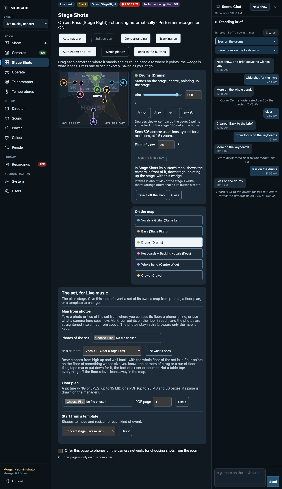

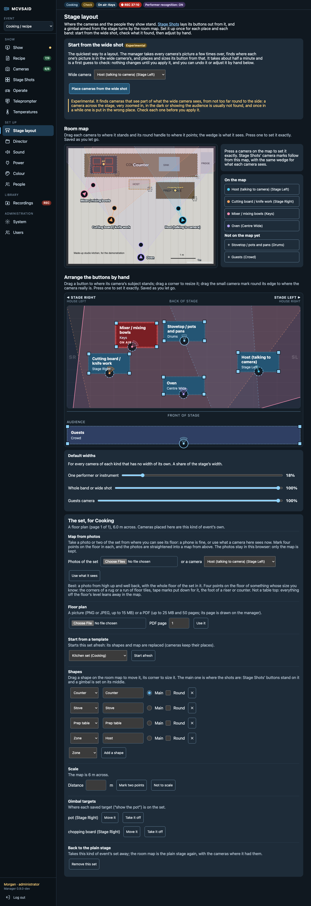

### 10. Frame-accurate sync, lip sync and colour matching across mixed phones

A hidden timing strip lines every feed up to the frame. **Calibrate sync** lines the sound up too: hold a phone or
tablet that flashes and beeps in front of the cameras, press Measure, and each camera's sound is set to match its own
picture, OBS's own delay included. Programme sound can come from one leading microphone, or follow whoever is
speaking, so phone microphones never echo. One page sets white balance and exposure on every phone and
builds a LUT for each camera. The LUT can come from a colour chart or from matching to a reference camera. The camera
relay cut OBS's memory use from 11.0 GB to 2.6 GB with six 4K cameras.

### 11. Recordings ready for the edit

Record and Stop catch the moment you press them, even though the programme runs a few seconds behind. With camera files
switched on, each programme recording comes with a file per camera, kept on the computer from the streams as they
arrive, the cuts as an EDL for Resolve, Premiere or Final Cut, and each camera's LUT; a cooking show's steps come as
markers where the file shows them. Phones can also record a sharper copy of their own, copied over and verified after
the show, but recording while streaming runs most phones too hot without a cooler, so try it on your phones first. You can re-cut the AI's show
instead of living with it.

### 12. Private, local and consent-based

Everything runs on one Mac or Linux computer, including the model, and nothing is sent to the project; MCVSAID goes online by itself only
to check for updates, from GitHub. Performer
recognition identifies only people who have consented, purpose by purpose. Their data is encrypted and deleted after
the show day, and every page shows when recognition is on. Face blur and voice shot calls run on the phones and the
computer too, never in a cloud service. AI is optional, so a modest computer can still run a show. Each person logs in
to the dashboard by name, with a role such as administrator, operator or Stage Shots only, and an administrator can
change anyone's role from the Users page. The audit log names who made each change.

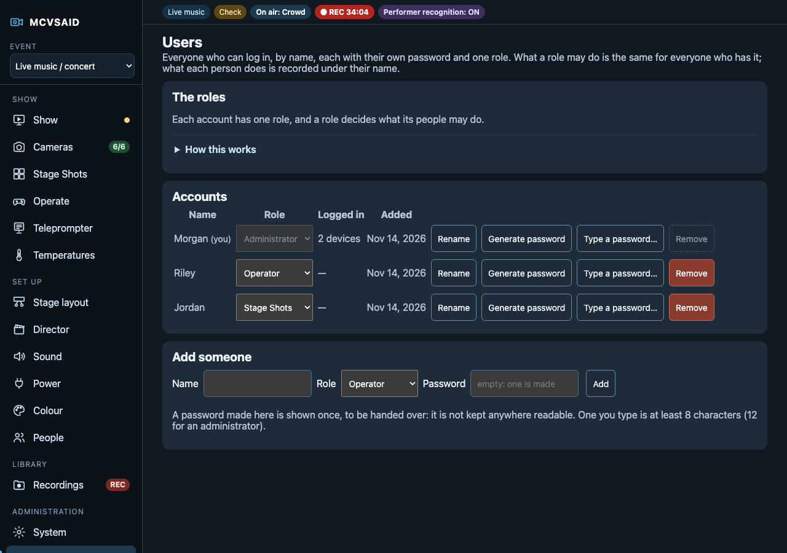

## Camera hardware: more camera for the money

MCVSAID runs on Android phones, so you choose the cameras: the ones that fit the show and the budget, changed as better
ones get cheaper. A flagship phone from the last few years has an image sensor about the size of a premium PTZ camera's and bigger than most 4K PTZ cameras', shoots
sharp 4K, and carries its own zoom lenses, and two or three years after launch it costs a few hundred dollars used.

| Phone | Used, November 2026 | Main camera | Zoom lenses | With MCVSAID |
| --- | --- | --- | --- | --- |
| Samsung Galaxy S23 | about $280 | 50 MP, 1/1.56" sensor | 3x, 10 MP | Tested, its 3x lens included |
| Samsung Galaxy S23 Ultra | about $490 | 200 MP, 1/1.3" sensor | 3x and 10x, 10 MP each | Not yet tried |
| Google Pixel 8 Pro | about $330 | 50 MP, 1/1.31" sensor | 5x, 48 MP | Not yet tried |
| Google Pixel 9 Pro | about $460 | 50 MP, 1/1.31" sensor | 5x, 48 MP | Not yet tried |
| Google Pixel 8 | about $280 | 50 MP, 1/1.31" sensor | none (12 MP ultrawide) | Tested |

The director uses a phone's zoom lens for tight shots, changing lens only while that camera is off air, and crops in on
the large main sensor between lenses. Put the phone on a **Hohem iSteady X3** (about $100–130; the cheaper X3 SE is a different model, not yet
tried) or **MT3** (from about $330) and it pans and tilts like a PTZ camera, aimed from the dashboard, a tablet or an Xbox controller, or
following a face by itself (see [6. Robotic cameras for the price of a phone gimbal](#6-robotic-cameras-for-the-price-of-a-phone-gimbal)).

| Camera | New or used, November 2026 | Sensor | Zoom |
| --- | --- | --- | --- |
| Galaxy S23 on a Hohem iSteady X3, with MCVSAID | about $400 | 1/1.56" (50 MP main) | 3x lens and sensor crop |
| A 4K PTZ camera with 12x zoom (for example PTZOptics Move 4K, Panasonic AW-UE20) | about $1,400–2,000 | 1/2.5"–1/2.8" | 12x optical, continuous |
| A 4K AI-tracking PTZ camera (OBSBOT Tail 2) | about $1,200 | 1/1.5" | 5x optical |

Used phone prices are typical asking prices for unlocked phones on Swappa; gimbal and camera prices are US retail. All
are in US dollars, as of November 2026, and they change. A PTZ camera's zoom is one continuous lens, where a phone moves
between fixed lenses and crops in between them. "Not yet tried" means that phone's zoom lenses have not yet been tried
with the app; the Pixel 8 and Galaxy S23 have.

## How it compares

The comparison below is based on the public pages linked under [References](#references), as of October 2026.

| Capability | MCVSAID | Switcher Studio | Blackmagic Camera (Android) | Mevo Multicam | Audio auto-switchers |
| --- | --- | --- | --- | --- | --- |
| Android phones as cameras | Yes, as a managed fleet | Yes, as sources | Yes | No, Mevo cameras only | Needs its own switcher |
| Live switching | Yes, into OBS | Yes, by the operator | No | Yes | Yes, in vMix, ATEM or TriCaster |
| Automatic shot choice | Vision model and rules | Not stated | No | Auto-director | Mic levels |
| Sees the shot before it airs | Yes, look-ahead | No | No | Not stated | No |
| Direction in plain language | Yes, Scene Chat, and shots called aloud | No | No | No | No |
| Phones on gimbals, aimed and following | Yes, X3 and MT3, from the dashboard or by voice | No | No | Not applicable | No |
| Faces blurred on the camera | Yes, with the computer as backup | No | No | No | No |
| Event-specific modes | 7 modes, karaoke included, plus Creator Studio | No | No | Not stated | Talk formats |
| Remote phone management and self-healing | Yes | No | Remote settings | Not applicable | Not applicable |
| Heat forecasting and cooler control | Yes | No | No | No | No |
| Per-camera files, EDL and LUTs | Yes | Not stated | Per-phone files | Not stated | No |
| Runs fully local, no subscription | Yes | No, monthly plan | Yes, free | App with a Pro plan | Yes, one-time licence |

"Not stated" means the pages we reviewed don't mention the feature; it may still exist. Product names belong to their
owners. Corrections are welcome at **hello@mcvsaid.com**.

## Requirements and limitations

- **A capable production computer.** MCVSAID has been tested on a gaming laptop with 32 GB of RAM and 16 GB of VRAM,
  and on a MacBook Pro with an M5 Pro and 48 GB of RAM. Smaller machines haven't been tested yet.
- **Dedicated phones.** Camera phones must be factory-reset and used only as cameras, because the app becomes each
  phone's device owner.
- **Heat.** Recording on the phones while they stream ran them too hot to use in our tests without a cooler. Keep
  each camera's file on the computer instead, or try a cooler and test on your own phones first.
- **Experimental parts.** Face blur can miss faces (small, turned, fast-moving or partly hidden), so don't rely on it
  to hide anyone yet. Cooler and gimbal control use commands worked out from the makers' own apps, so a firmware
  update could change them; only the Black Shark MagCooler 5 Pro and the Hohem iSteady X3 and MT3 have been tried. An
  MT3's built-in AI tracker can be seen from the dashboard, but only started and stopped at the gimbal. Charger plug
  control works with Tapo plugs through their local login, which TP-Link has changed before; a firmware update could
  break it. Saved targets are for things that stay put: a camera doesn't follow the pot if it's moved.
- **Delay.** The programme runs a few seconds behind real life, by design, so the director can see each moment first.
- **Platforms.** Cameras are Android only, output goes through OBS, and MCVSAID is in private beta.

## Try it

- **Demo:** the real dashboard with simulated cameras runs in your browser at
  [demo.mcvsaid.com](https://demo.mcvsaid.com/). Nothing is connected, and nothing you press leaves your browser.
- **Join the beta:** email **beta@mcvsaid.com** with what you film and how often, the computer you'd run it on, and
  the phones and network you have.

## References

- [MCVSAID demo dashboard](https://demo.mcvsaid.com/)
- [Switcher Studio review (Dupple)](https://dupple.com/reviews/switcher-studio)
- [Blackmagic Camera for Android 2.0 (AlternativeTo)](https://alternativeto.net/news/2025/1/blackmagic-camera-2-0-for-android-adds-multi-phone-control-extended-device-support-and-more)
- [Mevo Multicam app](https://mevo.com/pages/multi-camera-app)
- [Virtual Video Director](https://www.streamingvalley.nl/product/virtual-video-director-for-vmix-atem-and-tricaster/)
- Used phone prices: Swappa's price guides for the [Galaxy S23](https://swappa.com/prices/samsung-galaxy-s23),
  [S23 Ultra](https://swappa.com/prices/samsung-galaxy-s23-ultra), [Pixel 8](https://swappa.com/prices/google-pixel-8),
  [Pixel 8 Pro](https://swappa.com/prices/google-pixel-8-pro) and [Pixel 9 Pro](https://swappa.com/prices/google-pixel-9-pro),
  November 2026
- [Pixel camera specifications (Google)](https://support.google.com/pixelphone/answer/7158570)
- [Galaxy S23 series specifications (Samsung)](https://samsungmobilepress.com/media-assets/galaxy-s23?tab=specs)
- [Hohem store](https://store.hohem.com/)
- [PTZOptics Move 4K](https://ptzoptics.com/ptz-cameras/move-4k-12x)
- [OBSBOT Tail 2](https://www.obsbot.com/news/obsbot-tail-2-pre-order)
